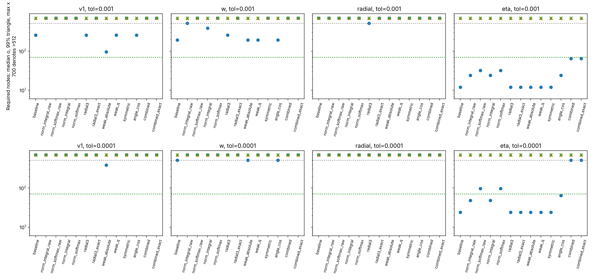
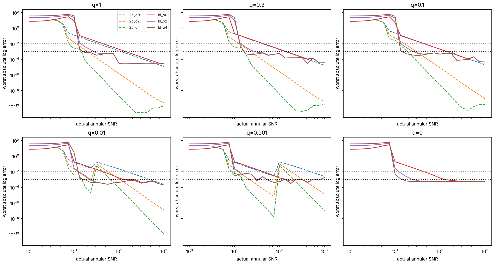
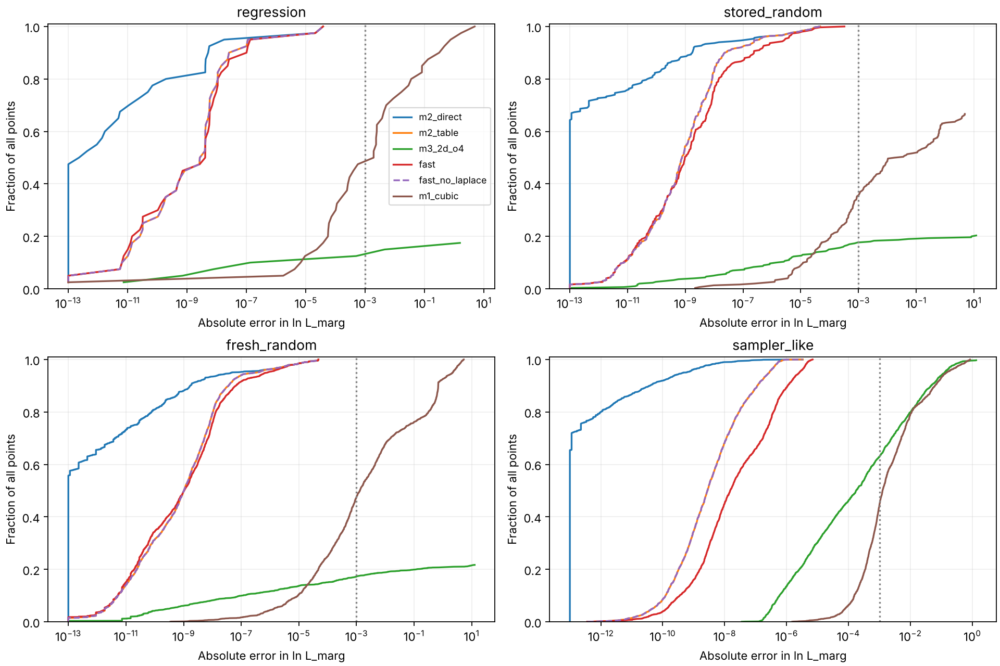
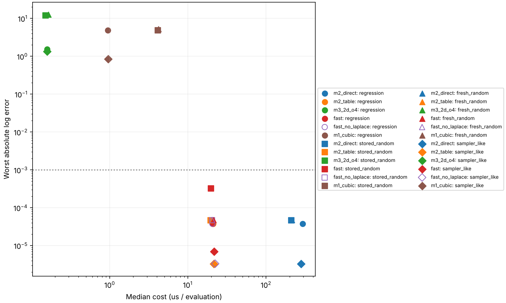
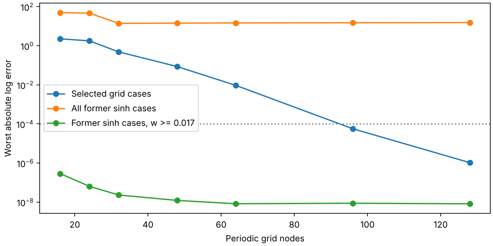
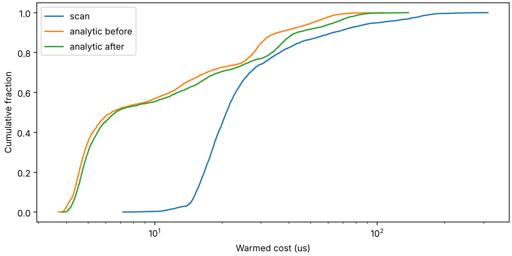

# Distance and polarization marginalization: final report

## 要約

距離と偏光角の周辺化には、距離積分の補間表と偏光角の数値積分を組み合わせる手法2を推奨する。
十分に高いSNRで、正の弱固有値を持ち、ピークが事前分布の境界から離れる場合には、
4次の2次元Laplace近似へ切り替える。通常の4次元格子は、遷移に合わせた座標と滑らかな
正規化を導入しても必要な精度とメモリ制約を満たさなかった。
以下の比較は同じ参照値を使用し、近似が適用できない点の割合も明記する。
反復009では、走査を行わない解析的な角度予測とGH12／固定48点格子を既定とした。
全4,340点と修復例で最大誤差5.27e-5、全体の中央値6.43 µs（旧方式20.8 µs）を得た。
ただし幾何計算の中央値1.53 µsは1 µsの目標を超え、フォールバックの99%コストも増加した。

以下は反復008の比較値であり、反復009の更新結果は末尾に示す。主要な数値（事前分布 $D_{\max}/D_{\min}=1000$、$(x_{\min},x_{\max})=(0.1,100)$、単一スレッド、JIT ウォームアップ後）:

- **手法 2（推奨）**: 距離カーネルの $(s,v)$ 2 次元テーブル（996×996、8 MB、構築 20 秒）+ θ 方向 64 節点の適応求積。
  同一の 4,340 点（回帰 40、保存乱数 300、新規乱数 2,000、模擬事後分布 2,000）で最大誤差 4.8e-5、
  中央値コスト 20 µs（99 パーセンタイル 170–180 µs）。テーブルを使わない直接計算では 210–290 µs。
- **手法 1（4 次元テーブル）**: 不可。3 次補間で $10^{-3}$ を満たすには 99 パーセンタイルで全軸 512 点超
  （$513^4 \approx 7\times10^{10}$ 点）。遷移に合わせた asinh 和座標・滑らかな正規化でも判定は不変。
  2e7 点の試作では誤差最大 4.8–5.3。
- **手法 3（Laplace 近似）**: 2 次元閉形式（4 次補正）は 0.16 µs だが、内部ピークかつ $\lambda_2>0$ に限られ、
  $10^{-3}$ を満たす SNR の下限は $q=\lambda_2/\lambda_1 \ge 0.3$ で 18（掃引セル最悪 32）、$q=0.1$ で 42、
  $q=0.01$ で 133、$q=0.001$ で 422。急峻方向のみ解析積分する 1 次元版は 39–57 µs で手法 2 より遅い。
- **ディスパッチャ `lnL_marg_fast`**: ゲート（内部ピーク、$\rho \ge 1.5\,\rho_{\rm break}(q)$）を通る 12–23% の
  呼び出しを Laplace 式に回し、残りは手法 2。全 4,340 点で最大誤差 3.3e-4、$10^{-3}$ 超はゼロ。
  中央値コストは手法 2 単独と同じ 21 µs（平均は Laplace 分だけ下がる）。

## 1. Problem and conventions

We evaluate the normalized likelihood ratio in [TASK.md §§1–2](TASK.md),
with the exponent from Eq. 17 of [dist_psi_marg.tex](dist_psi_marg.tex):

\[
 f(r,\theta)=r(A\cos\theta+B\sin\theta)
 -\tfrac12r^2(C\cos2\theta+D\sin2\theta+E),
 \qquad r=D_{\rm ref}/D_L,\quad\theta=2\psi.
\]

The domain is finite physical coefficients with
\(E\ge\sqrt{C^2+D^2}\) and \(0<x_{\min}<x_{\max}\).
The volume prior \(p(D_L)\propto D_L^2\) gives

\[
 L_{\rm marg}=\frac{3}{2\pi(x_{\min}^{-3}-x_{\max}^{-3})}
 \int_{x_{\min}}^{x_{\max}}r^{-4}\,dr\int_0^{2\pi}e^{f(r,\theta)}d\theta.
\]

Thus all five zero coefficients give exactly \(\ln L_{\rm marg}=0\).
Rotating by \(\xi=\frac12\operatorname{atan2}(D,C)\) gives
\(\lambda_1=E+S,\lambda_2=E-S,S=\sqrt{C^2+D^2}\),
\(R=\sqrt{A^2+B^2}\), and \(\eta=\operatorname{atan2}(B,A)-\xi\).
Full-circle and reflection symmetries fold \(\eta\) into \([0,\pi/2]\).
In Cartesian principal axes the exponent is
\(-\lambda_1s^2/2-\lambda_2t^2/2+R\cos\eta\,s+R\sin\eta\,t\),
and the measure is \((s^2+t^2)^{-5/2}ds\,dt\).

The scaling
\((A,B,C,D,E,x_{\min},x_{\max})\mapsto
(A/c,B/c,C/c^2,D/c^2,E/c^2,cx_{\min},cx_{\max})\)
preserves the normalized answer. One table per radial-bound ratio is sufficient,
provided coefficients are rescaled into that table's bounds.
SNR means \(\rho=\sqrt{2\max(0,\max f)}\), maximizing over the finite annulus.
The zero clipping handles negative maximum log likelihoods. The random-generation
proxy \(R/\sqrt{\lambda_1}\) is a different quantity and can yield actual SNR above 300.

## 2. Reference and validation

[dpmarg/reference.py](dpmarg/reference.py) contains two independent numerical
integrators: nested adaptive SciPy quadrature on the full annulus, and 25-digit
mpmath tanh-sinh quadrature using the four-quadrant cosh identity. They share
coefficient conventions and geometric partition guidance, but no quadrature
values. Peak shifts, Gaussian and exponential endpoint scales, and geometric
radial partitions keep narrow and exterior peaks numerically visible. There is
no small-radius regulator and no extension to an infinite prior domain.

The [40-point regression set](data/regression_points.json) contains 20 named
extremes and 20 seed-1 random cases: zero coefficients, nonzero penalty with
\(R=0\), isotropic and degenerate eigenvalues, \(\lambda_1=10^8\), both exterior
radial peaks, two comparable angular lobes, and low through high SNR. The two
integrators agree within **3.4e-11** on that set (iteration 001). Independent
Bessel-integral, symmetry, and maximum-location tests supplement the comparison.
The historical reference median cost is 0.138 s/evaluation; it is a validation
engine rather than a sampling engine.

The final comparison uses four shared input sets:

- All 40 saved regression points.
- All 300 saved random references: 200 with bounds [0.1,100] and 100 with
  [0.1,10], retained without recomputing their reference values.
- 2,000 fresh random points from `random_params(2000,808)`, bounds [0.1,100].
  The generator samples log-uniform \(\lambda_1\in[10^{-4},10^8]\), uniform
  \(q=\lambda_2/\lambda_1\) with 10% atoms each at 0 and 1, log-uniform proxy
  SNR in [0.1,300] with a 10% zero atom, uniform \(\eta\), and a random rotation.
- 2,000 mock-posterior points, seed 809, bounds [0.1,100]. Actual interior SNR
  is log-uniform [5,50], \(q\) uniform [0.05,1], \(\eta\) uniform [0,π/2],
  Cartesian peak radius log-uniform [0.5,5], and rotation uniform [0,π].
  For \(k=\cos^2\eta+\sin^2\eta/q\),
  \(h=\sqrt{\cos^2\eta+\sin^2\eta/q^2}\), choose
  \(\lambda_1=(\rho h/(\bar r\sqrt{k}))^2\),
  \(\lambda_2=q\lambda_1\), \(R=\rho\sqrt{\lambda_1/k}\).
  This fixes the stated SNR and peak radius exactly. It is a synthetic test
  distribution, not an astrophysical posterior or a measured sampler workload.

Both new sets use `lnL_marg_ref`, with the restartable coefficient-keyed cache
`data/final_reference_full.json`. Full values, branch codes, and individual
costs are in `data/final_benchmark_full.json`; both large files are git-ignored.
The reference comparison supports empirical accuracy over these sets, not an
analytic error bound over every physically valid coefficient.

## 3. Methods and measured comparison

### Method 2: radial table plus adaptive angular quadrature

For fixed principal-axis angle,
\(a=R\cos(\theta-\eta)\),
\(b=\lambda_2+(\lambda_1-\lambda_2)\cos^2\theta\).
The distance kernel integrates \(r^{-4}\exp(ar-br^2/2-f_{\max})\).
The direct implementation uses peak-centered logarithmic panels and a
controlled exponent-drop window with 24-point Gauss–Legendre panels. Its
iteration-002 errors were below 8.3e-10 on the scalar validation grid;
its several-microsecond cost per radial integral motivates interpolation.

The angular implementation pairs the opposite signs as \(J(a)+J(-a)\), with
an analytically justified skip when one sign is negligible. A 64-point proxy
scan and 28-step refinements locate angular peaks. Depending on their widths
and multiplicity, it uses a periodic uniform rule, a sinh-stretched trapezoid
with the first Euler–Maclaurin endpoint correction, or Gauss–Legendre on two
sinh patches. Nested 16/32/64-node rules stop at a log difference below 2e-6;
64 is the default maximum node budget, with up to 128 radial evaluations.
This convergence check and the finite budget are empirically validated.

Two geometry repairs matter. Iteration 005 retained the seed and a narrow
refinement when a broad non-unimodal golden-section bracket abandoned a weak-axis
peak. The final fresh seed-808 set exposed an additional failure: two broad
proxy maxima could displace a narrower third contribution at large radius.
The previous uniform rule erred by 0.591 and 0.0119 on cases 44 and 915.
When the selected scan peaks are broad, the geometry now checks the analytic
weak-axis seed, its curvature width, and its proxy height (within 40 log units).
It requires a local maximum on the seed's own width scale and recomputes
curvature after refinement to reject minima and clipping cusps. It then
stretches the entire period about a relevant narrow seed, resolving both
contributions within the existing budget. Regression tests preserve these cases.
Exact unit-likelihood normalization is also preserved at all-zero coefficients.

Iteration 004 measured a radial table/reference error below 2e-6 on independent
physical and coordinate probes, and a method-2 table/direct change below 5e-7
on the saved likelihood sets. At 64 nodes, its direct/table median costs were
242/21 µs, worst likelihood error 4.69e-5; raising the angular budget to 128
reduced that worst error to 1.89e-6. These are historical measurements;
the common final measurements below include the latest geometry repair.

### Method 1: regular four-dimensional interpolation, rejected

The iteration-005 prototype stores \(\ln L_{\rm marg}-\ln L_{\max}\)
on a triangular eigenvalue mapping, a regularized dominant-ray radial coordinate,
and a folded angle. Tensor cubic interpolation reads 256 samples, linear reads
16. The 66×66×66×69 prototype contains **19,837,224 float64 entries**
(**158,697,792 bytes**) and took **806.15 s** to build. Its historical cubic
worst errors were 4.821 on regression and 4.823 on the main-prior saved random
points, despite roughly 4–5 µs full evaluation cost. Exterior coordinate points
fall back to method 2; in-box interpolation errors remain exposed.

The first slice study used 220 bases, 1,025 fine nodes per axis, and coarse
resolutions 8–512. Median cubic requirements for 1e-3 were 256,192,>512,12 on
strong eigenvalue, weak eigenvalue, radius, and angle. Every axis needed >512
nodes at the 99th percentile. Several distinct physical scales cause this:
\(R x_{\min}\sim1\) changes the angular normalization long before radial
crossings at \(R\sim b x_{\min}\); weak-axis degeneracies and radial boundaries
create thin parameter-dependent layers. Subtracting \(\ln L_{\max}\) also adds
cusps when competing maxima exchange dominance even though the integral is smooth.

Iteration 007 repeated the slice study with sums of transition-aligned asinh
coordinates, alternative weak-axis mappings, a cosine angle, symmetric geometry,
and smooth integral/soft-maximum normalizations, individually and combined.
Regularization removed the measured cusp slope (~100 down to <2e-7), and some
single-axis medians improved. **Every tested design, interpolation rule, axis,
and tolerance still required >512 nodes at the 99th percentile.** Thin layers
remained; fixed angular-grid normalizations also aliased narrow peaks. The
verdict therefore did not change. Even 513⁴ requires 69.3 billion samples,
554 GB, and about 32 days at the measured generation rate, without an accuracy
certificate. No second large prototype was justified. These results reject the
tested separable regular grids; adaptive patches or other representations remain
possible. See [TABLE4D.md](TABLE4D.md),
[the first slice summary](data/method1_slices.json), and
[the revised slice summary](data/method1b_slices.json).



### Method 3: annulus-aware Laplace expansions

The implemented two-dimensional formula expands the Cartesian prior factor
\(h=(s^2+t^2)^{-5/2}\) about the Gaussian likelihood peak, through Taylor
orders 0,2,4. Its leading term is
\(\mathrm{norm}+f_{\rm peak}+\ln(2\pi)-\frac12\ln(\lambda_1\lambda_2)-5\ln\bar r\),
with the Gaussian expectations of the second/fourth derivatives supplying
corrections. Independent Gauss–Hermite tests verify the expected error powers
\(\rho^{-2},\rho^{-4},\rho^{-6}\) in the smooth interior regime.

It requires positive \(\lambda_2\) and
\(x_{\min}+3/\sqrt{\lambda_2}<\bar r<x_{\max}-3/\sqrt{\lambda_2}\).
Invalid geometry or a nonpositive correction returns NaN. This guard contains
a three-sigma weak-axis ellipse, but cannot by itself exclude a competing
prior-dominated contribution. Low-SNR finite outputs can be very inaccurate.

The one-dimensional variant integrates the stiff Gaussian direction using
truncated Gaussian moments and a Taylor expansion of the prior, respecting
both annular intervals, then numerically integrates the weak direction.
Iteration 006 swept 4,525 reference points; 29 requested geometry cells were
mathematically unattainable and explicitly excluded. The worst sampled 1e-3
thresholds, requiring every larger sampled SNR to pass, were:

| q | 2-D order 4, interior geometries | 1-D order 4, 96 nodes |
|---:|---:|---:|
| 1 | 17.8 | 17.8 |
| 0.3 | 31.6 | 17.8 |
| 0.1 | 42.2 | 17.8 |
| 0.01 | 133 | 17.8 |
| 0.001 | 422 | 17.8 |
| 0 | unavailable | 17.8 |

At 48 nodes the 1-D variant still had a 0.00170 error in one strongly
anisotropic inner-boundary cell at SNR 1000; doubling nodes resolved that
quadrature limitation. It costs 39–57 µs, versus ~21 µs for table-backed method 2,
and is unsafe at low SNR without fallback. It therefore has no measured
performance niche. The 2-D formula costs ~0.15 µs historically and is useful
behind a stricter gate. Complete angle/radius-dependent 1e-3 and 1e-2 thresholds
are in [data/method3_breakdown.md](data/method3_breakdown.md), with derivations
in [METHOD3.md](METHOD3.md). Thresholds between swept grid points are empirical.



### Final shared-set results

All errors below are absolute errors in \(\ln L_{\rm marg}\).
Error fractions and cost statistics use **available outputs only**. Availability
is explicit: standalone method 3 uses its native geometric guard, including
inaccurate low-SNR outputs; the rejected method-1 prototype only supports its
[0.1,100] prior. The 100 secondary-prior saved points remain unavailable for
that prototype. All four production/direct variants evaluate every point.

Timing is single-thread wall-clock after JIT warm-up. For each point the median
of three repeated compiled loops is measured, then the median and 99th percentile
are taken across points. Loop repetitions are 16 for direct method 2, 32 for
table/dispatcher, 512 for standalone 2-D Laplace, and 128 for the 4-D prototype.
These are warm, repeated-point costs; they are not cold-cache or sampler-latency
percentiles. The final timings are collected without concurrent test workloads.

| Set | Method | Available | Max error | 99% error | Median error | >1e-3 | >1e-2 | Median / 99% us |
|---|---|---:|---:|---:|---:|---:|---:|---:|
| regression | m2_direct | 40/40 | 3.78196e-05 | 3.11686e-05 | 3.27766e-13 | 0.000% | 0.000% | 292.9 / 1128 |
| regression | m2_table | 40/40 | 3.78196e-05 | 3.11503e-05 | 3.30455e-09 | 0.000% | 0.000% | 21.14 / 164.5 |
| regression | m3_2d_o4 | 7/40 | 1.54199 | 1.44974 | 1.33338e-07 | 28.571% | 14.286% | 0.1589 / 0.1788 |
| regression | fast | 40/40 | 3.78196e-05 | 3.11503e-05 | 4.07245e-09 | 0.000% | 0.000% | 20.68 / 163.7 |
| regression | fast_no_laplace | 40/40 | 3.78196e-05 | 3.11503e-05 | 3.30455e-09 | 0.000% | 0.000% | 20.58 / 169.3 |
| regression | m1_cubic | 40/40 | 4.82119 | 3.59521 | 0.00190826 | 52.500% | 27.500% | 0.9483 / 39.4 |
| stored_random | m2_direct | 300/300 | 4.6903e-05 | 2.40077e-05 | 1.55431e-15 | 0.000% | 0.000% | 209.7 / 901.7 |
| stored_random | m2_table | 300/300 | 4.6903e-05 | 2.40077e-05 | 7.6848e-10 | 0.000% | 0.000% | 19.63 / 76.08 |
| stored_random | m3_2d_o4 | 61/300 | 11.9674 | 9.71544 | 2.5927e-06 | 13.115% | 9.836% | 0.1508 / 0.1834 |
| stored_random | fast | 300/300 | 0.000325981 | 2.71592e-05 | 9.69816e-10 | 0.000% | 0.000% | 19.76 / 84.26 |
| stored_random | fast_no_laplace | 300/300 | 4.6903e-05 | 2.40077e-05 | 7.6848e-10 | 0.000% | 0.000% | 20.35 / 102.2 |
| stored_random | m1_cubic | 200/300 | 4.82303 | 4.37859 | 0.000728131 | 47.000% | 27.500% | 4.137 / 20.51 |
| fresh_random | m2_direct | 2000/2000 | 4.75703e-05 | 1.66976e-05 | 9.9365e-15 | 0.000% | 0.000% | 213.8 / 1115 |
| fresh_random | m2_table | 2000/2000 | 4.75703e-05 | 1.67026e-05 | 1.02409e-09 | 0.000% | 0.000% | 20.06 / 169.9 |
| fresh_random | m3_2d_o4 | 434/2000 | 12.6355 | 9.69745 | 3.37301e-07 | 20.507% | 13.134% | 0.1645 / 0.188 |
| fresh_random | fast | 2000/2000 | 4.75703e-05 | 1.67026e-05 | 1.04882e-09 | 0.000% | 0.000% | 21.24 / 182.9 |
| fresh_random | fast_no_laplace | 2000/2000 | 4.75703e-05 | 1.67026e-05 | 1.02409e-09 | 0.000% | 0.000% | 20.42 / 169.8 |
| fresh_random | m1_cubic | 2000/2000 | 5.28125 | 4.29022 | 0.00130715 | 52.550% | 32.200% | 4.227 / 20.2 |
| sampler_like | m2_direct | 2000/2000 | 3.31338e-06 | 9.85974e-09 | 1.42109e-14 | 0.000% | 0.000% | 279.5 / 721.9 |
| sampler_like | m2_table | 2000/2000 | 3.31976e-06 | 5.31818e-07 | 2.76159e-09 | 0.000% | 0.000% | 21.38 / 179.5 |
| sampler_like | m3_2d_o4 | 1994/2000 | 1.33145 | 0.366605 | 0.000172877 | 36.861% | 19.860% | 0.1592 / 0.1901 |
| sampler_like | fast | 2000/2000 | 6.95472e-06 | 4.82336e-06 | 1.49752e-08 | 0.000% | 0.000% | 21.74 / 187.9 |
| sampler_like | fast_no_laplace | 2000/2000 | 3.31976e-06 | 5.31818e-07 | 2.76159e-09 | 0.000% | 0.000% | 22.33 / 183.1 |
| sampler_like | m1_cubic | 2000/2000 | 0.840779 | 0.621112 | 0.00125756 | 55.350% | 20.850% | 0.9555 / 1.223 |

Dispatcher branch fractions (without Laplace: 100% method 2):

| Set | Method 2 | Laplace |
|---|---:|---:|
| regression | 90.000% | 10.000% |
| stored_random | 88.000% | 12.000% |
| fresh_random | 87.900% | 12.100% |
| sampler_like | 76.850% | 23.150% |

Table construction (JIT excluded, guards included):

| xmax | Build s | Coefficient bytes | Guard bytes | Flagged cells |
|---:|---:|---:|---:|---:|
| 100 | 20.472 | 8000000 | 990025 | 0.816% |
| 10 | 18.364 | 8000000 | 990025 | 0.343% |

The CDF denominator is the full input set, so unavailable methods stop below one.





## 4. Recommendation and table construction

Iteration 009 updates method 2 to the scan-free analytic rule described below.
Use `dpmarg.lnL_marg_fast(A,B,C,D,E,xmin,xmax,table)` for the measured mixture,
or `use_laplace=False` for exactly the table-backed method-2 result. Both scalar
and array functions compile in Numba. `fast_diagnostics` and
`fast_array_diagnostics` return values and branch codes (0=method 2, 1=Laplace).
Array inputs are (n,7) rows of A,B,C,D,E,xmin,xmax and use one matching table.
Tables are immutable evaluation tuples and can be reused across calls.

The production radial table stores the smooth residual \(H=\ln I-\ln G\),
where G is the analytic truncated Gaussian integral with the same peak shift.
The frozen-prior alternative \(\ln I-\ln(r_*^{-4}G)\) jumps at a=b=0
and has clipped-radius kinks; raw \(\ln I\) also interpolates less accurately.
The recommended table design is:

\[
 s=\operatorname{asinh}\frac{a-bx_{\min}}{\sigma}
  +\operatorname{asinh}\frac{a-bx_{\max}}{\sigma},\quad
 v=\operatorname{asinh}(b/b_{\rm ref}),\quad
 \sigma=\sqrt{b+\sigma_0^2},\quad
 \sigma_0=(x_{\max}-x_{\min})^{-1},\quad b_{\rm ref}=x_{\max}^{-2}.
\]

Use 996×996 physical nodes, |s|≤24, b≤1e8, with cubic B-spline coefficients
and two retained coefficient guards at each edge: exactly 1,000,000 doubles,
8 MB. A 995×995 boolean mask adds 990,025 bytes. Five direct-kernel probes per
cell flag errors above 2e-6; flagged cells use direct radial quadrature.
For b>bmax use direct quadrature. Exterior s uses an 18-term endpoint series
only when its small-parameter and tail checks pass; otherwise use direct
quadrature. [TABLE1D.md](TABLE1D.md) states the conditions and validation results.
Direct method 2 and standalone Laplace require no likelihood table. The
dispatcher and table-backed method 2 use 8,990,025 bytes per prior; the rejected
4-D prototype additionally retains its 158.7 MB grid and a radial fallback table.
The mask and the asymptotic applicability checks are empirical safeguards,
not a proof of uniform interpolation accuracy.

The dispatcher gate uses positive \(\lambda_2\), the method-3 three-sigma
interior guard, and \(\rho\ge1.5\rho_{\rm break}(q)\), with monotone log-log
interpolation through (q,threshold)=(.001,422),(.01,133),(.1,42),(.3,18).
For q≥.3 the base threshold is 18; for q<.001 Laplace is disabled. The required
SNR is computed cheaply as
\(\rho^2=\lambda_1\bar s^2+\lambda_2\bar t^2=2f_{\rm peak}\), since the
geometric guard establishes an interior peak. A nonfinite closed-form result
falls back to method 2. Table bounds are checked even when Laplace serves a call.
Constants and their meanings are documented in [dpmarg/fast.py](dpmarg/fast.py).

The q=.3 synthesis threshold of 18 follows this iteration's requested gate;
the worst iteration-006 q=.3 interior sweep cell required 31.6. The 1.5 margin
makes the operational threshold 27 at q≥.3, rather than reproducing every
sweep-cell maximum. Consequently the final validation establishes measured
performance of this gate, not a uniform guarantee over unsampled boundary layers.
An additional audit of the saved iteration-006 sweep accepts **1,075/4,525** points, with maximum accepted-branch error
**3.59107e-06** and no errors above 1e-3. This check uses the unchanged
2-D formula's cached reference errors and is separate from the four final sets.
For a new prior or a demand for an error certificate, use method 2 and validate
or recalibrate the gate, particularly near either boundary.

Across all **4,340 points**, the dispatcher has maximum absolute log error **0.000325981**, 99th-percentile error **8.92569e-06**, and median error **4.35605e-09**. No point exceeds either 1e-3 or 1e-2. Its overall median cost is **21.245 µs**, with a 99th-percentile point cost of **183.838 µs**. The pooled workload serves **17.166%** with Laplace and **82.834%** with method 2. The separate-set branch fractions above are more informative for an application than this arbitrary pooled mixture. In the mock posterior, the dispatcher costs **21.742 µs** median and uses Laplace on **23.150%** of points. General-path fallback tails exceed the median speed target; the few-to-tens of microseconds target in TASK.md is met as a median, as specified.

The optional Laplace branch does **not** improve the pooled median in this
experiment: table-backed method 2 costs 20.348 µs versus
21.245 µs for the dispatcher. The replaced calls were often already among
the cheaper method-2 calls, and remaining calls pay the gate overhead. For an
accuracy-focused or median-cost baseline, use `use_laplace=False`; enable the
branch where the application's high-SNR workload justifies it. Its measured
worst error remains below the requested tolerance.

To change the distance prior bounds while retaining the volume-prior form,
build `build_table(xmin,xmax)` or use the builder below. For the main prior,
sigma0=0.01001001001 and bref=1e-4; for [0.1,10], sigma0=0.10101010101 and
bref=0.01. New xmax/xmin ratios need their own table and validation. For a
ratio already covered, choose c to map both physical bounds to a saved table's
bounds, then transform A,B by 1/c and C,D,E by 1/c² before evaluation. A change
of Dref alone scales both radial bounds and the coefficients consistently;
it does not create an independent table dimension. The API checks exact bound
matching and does not perform this rescaling automatically.

```python
from dpmarg import build_table, load_table, lnL_marg_fast
from dpmarg.table1d import save_table

table = build_table(.1, 100.)
save_table('data/my_volume_prior.npz', table)
# Later: table = load_table('data/my_volume_prior.npz')
value = lnL_marg_fast(A, B, C, D, E, .1, 100., table)
```

## 5. Limitations, completion status, and reproduction

Accuracy is demonstrated on the documented regimes and parameter sets; neither
the angular stopping rule, guarded interpolator, nor Laplace gate is a formal
uniform certificate. A new geometry distribution can expose missed modes, as
the fresh seed-808 experiment did. Guard-cell probes can miss unsampled cell
extrema. Adaptive guard certification or coordinates including the total
endpoint slope a−bx−4/x could reduce direct fallbacks and strengthen validation.

Geometry remains a material part of the method-2 cost (iteration 004: 3.68 µs,
18% of median cost). Reusing safe geometry between nearby posterior points or
improving peak estimates could help, but must preserve secondary modes. Larger
bmax values increase covered curvature at fixed table size and can require more
guards; a 1e10 extension was validated in iteration 004, but the defaults retain
1e8. Extreme coefficients beyond the tested range can challenge floating-point
arithmetic and fixed node budgets.

Other distance priors require a different radial weight, normalization, and
new tables; the present kernel is specifically for D_L². Higher-order Laplace
terms may reduce its safe SNR threshold but can worsen out-of-regime results.
A boundary-aware closed form would address the narrow transition bands more
directly. GPU batching and vectorization are plausible future optimizations;
the present array APIs use serial compiled loops, and no GPU speedup is claimed.
A smooth switch between fast and general paths might benefit gradient samplers;
this dispatcher switches branches sharply and has no derivative guarantee.

Verification: `python -m pytest tests -q` completed with **448 passed in 165.46 s**, including slow tests (one SciPy integration warning in a high-SNR gate-boundary test). `python scripts/final_benchmark.py` completed; the isolated final measurement pass took **159.50 s** using the cached references. All 4,000 new reference calls completed without warnings; their accumulated integration time was **540.87 s**. The dispatcher returns finite results on all 4,340 inputs and meets the 1e-3 target on every point. Disabling Laplace is bitwise identical to table-backed method 2 on all four complete sets.

The production accuracy, median-speed, reference-validation, report, and figure criteria in TASK.md §4 are met on the documented tests. One strict comparison coverage item remains unmet: method 1 was evaluated on 4,240 rather than all 4,340 points, because its single fixed-prior prototype cannot evaluate the 100 secondary-prior stored inputs. It was not rebuilt for that prior after both slice studies rejected the design. The measured method-1 accuracy and build-time failures, and the standalone method-3 unavailable/unsafe regimes, are negative results in the comparison; neither is recommended as a whole-domain evaluator.

Reproduce from `dist_psi_marg/` using the existing Python environment:

```bash
python scripts/build_table1d.py
# Optional: rebuild the rejected 159 MB method-1 prototype (~13 minutes).
python scripts/build_table4d.py
python scripts/final_benchmark.py
python -m pytest tests -q
```

The final benchmark rebuilds both radial tables with warmed construction timing,
reuses the large method-1 prototype when present, and reuses its restartable
reference cache. If that prototype is absent, it records method 1 as unavailable;
run its builder to reproduce every row. To compute only new references first,
use `python scripts/final_benchmark.py --reference-only`. Rebuilding a missing
cache computes 4,000 full reference integrals. There are no downloads or package
installs. Large generated tables, cache files, per-point dumps, and run logs stay
under `data/` and are ignored by git.

| File | Purpose |
|---|---|
| `dpmarg/fast.py` | Production dispatcher, gate constants, compiled arrays and diagnostics |
| `dpmarg/method2.py`, `dpmarg/kernel1d.py` | Angular quadrature and direct radial kernel |
| `dpmarg/table1d.py` | Radial table construction, interpolation, guard and fallbacks |
| `dpmarg/method3.py`, `METHOD3.md` | Two-dimensional and stiff-direction Laplace implementations |
| `dpmarg/table4d.py`, `TABLE4D.md` | Rejected regular-grid prototype and alternative-coordinate study code |
| `dpmarg/reference.py`, `dpmarg/params.py`, `dpmarg/regimes.py` | Independent references, parameter reduction/SNR, synthetic regimes |
| `scripts/final_benchmark.py` | Shared inputs, reference cache, final timing and figures |
| `tests/test_fast.py` | Saved-set accuracy, gate and branch checks, normalization and extremes |
| `data/final_benchmark.json`, `data/final_benchmark.md` | Small final machine/readable summaries |
| `data/final_reference_full.json`, `data/final_benchmark_full.json` | Ignored reference cache and per-point measurements |
| `data/method1*_slices.json`, `data/method2_summary.md`, `data/method3_summary.md` | Prior-iteration numerical evidence |
| `figures/final_error_cdf.png`, `figures/final_cost_vs_error.png` | Final shared-set comparison figures |

## Iteration 009: analytic geometry, Gauss–Hermite / fixed grid

The new default is `lnL_marg_m2_table(..., rule='analytic')` and the method-2
branch of `dpmarg.fast` uses it explicitly. `rule='scan'` retains the previous
64-sample geometry and nested quadrature. The direct-kernel method remains
unchanged. `use_laplace=False` still returns exactly the default table-backed
method 2; the separate 2-D Laplace gate and its accuracy limits are unchanged.

### Geometry and its domain

For the paired, pi-periodic integrand, put
\(a=|R\cos(\theta-\eta)|\),
\(b=E+S\cos2\theta=\lambda_1\cos^2\theta+\lambda_2\sin^2\theta\).
The interior leading exponent is \(a^2/(2b)\). Differentiation with
\(\phi=2\theta\) gives

\[
 E\sin(\phi-2\eta)-S\sin\phi=S\sin2\eta,
 \quad \rho'\sin(\phi-\delta)=S\sin2\eta,
\]

where \(\rho'=\operatorname{hypot}(E\cos2\eta-S,E\sin2\eta)\) and
\(\delta=\operatorname{atan2}(E\sin2\eta,E\cos2\eta-S)\).
The maximum is \((\delta+\arcsin(S\sin2\eta/\rho'))/2\), modulo pi;
the other root is the zero-numerator minimum. The stable implementation is

\[
 \theta_* = \operatorname{atan2}(\lambda_1\sin\eta,
                                \lambda_2\cos\eta)\pmod\pi.
\]

This is the direction of the completed-square Cartesian peak, equivalently
the maximum of a rank-one generalized Rayleigh quotient. It avoids cancellation
in the inverse sine near degeneracy. The flat ridge at `lam2=0, eta=0` needs
the prior and finite radial bounds. Tests compare both closed forms with an
independent dense-bracketed maximization on 200 random cases to 1e-10 in height.

`dpmarg/geometry.py` first finds extrema of the continuous historical proxy
\(q=f_{\max}-4\ln r\), \(r=\mathrm{clip}(a/b)\). Its small seed set includes
both interior stationary directions, the weak and stiff axes, eta, endpoint
weak-axis offsets and both sides of the zero-numerator direction. Safeguarded
Newton steps solve a crossed `a=b*xmin` cusp directly. Zero-signal, isotropic,
well-enclosed high-SNR and wholly lower-clipped sharp cases have analytic fast
paths. Candidates within 40 log units are retained, merging centers closer
than their smaller width. Midpoint cuts partition the entire period; no scan,
golden-section search or distance-kernel call occurs in the new geometry.

The smooth-branch derivatives are analytic. In the interior,
\(r'=(a'-b'r)/b\), \(r''=(-a-b''r-2b'r')/b\), giving

\[
 q'=a'r-\tfrac12b'r^2-4r'/r,\qquad
 q''=-ar-\tfrac12b''r^2+(a'-b'r)r'
      -4[r''/r-(r'/r)^2].
\]

The full interior Laplace proxy adds \(\tfrac12\ln(2\pi/b)\), whose
curvature correction is \(-[b''/b-(b'/b)^2]/2\). At a clipped endpoint it
adds \(-\ln|a-br|\), whose correction is
\(-(a''-b''r)/(a-br)+[(a'-b'r)/(a-br)]^2\); the radius is constant there.
Newton refinement on this full proxy supplies the GH center and
\(w=\min(0.3,1/\sqrt{-p''})\). GH geometry requires four radial standard
deviations to both boundaries and \(r\sqrt b>6\), or an endpoint slope
\(|a-br|>6\sqrt b\) and \(|a-br|r>20\). These are empirical selection guards,
not approximations to the likelihood value: every retained node uses the radial table
and its existing certified opposite-sign skip and guarded fallbacks.

The clipped proxy is only continuous at a radial clipping transition;
\(p''\) does not exist there, and the raw endpoint-layer approximation is
singular at zero slope. Applying its curvature there would repeat the
iteration-008 spurious-width failure. Those regimes use the continuous proxy
and conservative one-sided widths, followed by a grid or full-period sinh rule.
Neither third nor fourth derivatives are used: the Hermite order is fixed by
the reference sweep rather than a non-Gaussianity-based order formula.

### Cost-tail repair: rules and certified node pruning

GH retains order **12**, a sharp-width switch of **0.2**, the radial-asymptote
guards, and the requirement that its nodes fit within one period. Separate
clusters must be farther apart than six times the sum of their widths.
Candidates are pruned from the GH mixture only at an 18-log estimated mass
gap. The old eight-width drop probes have been removed. Instead, **16 uniform
precomputed probes** estimate the pedestal mass outside the union of
six-width windows. GH is accepted only when that mass is below **1e-6** of
\(\exp(p_*)\sqrt{2\pi}w\). This is a selection estimate, checked by the
reference sweep; it is not a rigorous bound on unsampled angular mass.

Failed GH cases use precomputed periodic grids **48/64/96/128**, selected by
\(\pi/N\le1.3w\), with a 128-node cap. The non-GH resolution widths include a
**0.8 safety factor** on proxy widths. Near the weak axis they also resolve
the fixed-radius angular curvature at the radial exponent mode and the
prior's RMS scale \(\sqrt3x_{\min}\). Nearly null rays retain the much narrower
upper-radius core scale \(1/(x_{\max}\sqrt{\lambda_1-\lambda_2})\).
These additions are necessary: clipping maxima of the continuous proxy can
hide larger-radius mass, and the zero-linear-signal null-axis profile has
algebraic Fourier convergence rather than Gaussian convergence. The raw
curvature width alone produced errors up to 0.0184 with the proposed grids.
Three selected points reach the 128-node cap with conservative widths below
\(\pi/(128\times1.3)\); all pass the reference check. This is the only spacing
cap exception, and their errors are recorded in the full dump.

A single narrow island with significant pedestal retains the iteration-003
**64-node corrected sinh trapezoid**, only when its conservative resolution
width is **below 0.017**. Two overlapping narrow peaks with comparable widths
use **32 Gauss–Legendre nodes per sinh interval**. A third retained peak can
require a third interval (three of 4,347 evaluations). A narrow island on a
much broader pedestal uses one full-period sinh patch. There is no nested
angular refinement. Diagnostic overrides can force a periodic grid or double
the chosen nodes; grids beyond 128 in this diagnostic evaluate trig directly.
The production grid uses precomputed sine/cosine factors, evaluating
\(b=\lambda_2+(\lambda_1-\lambda_2)\cos^2\theta\) to avoid weak-axis cancellation.

Before radial lookups, every node gets a weighted proxy score
\(p_L+\ln\omega\). `_node_proxy(a,b,...)` reproduces the Laplace proxy where its
radial asymptote is valid and the continuous proxy elsewhere; it needs no
trig or derivatives once grid coefficients are available. The chosen margin
is **M=40**. Width terms are not uniformly bounded at clipping, so the proxy
alone is not treated as a certificate. A second, cheap bound certifies every
candidate omission. For \(r=\mathrm{clip}(|a|/b)\),

\[
 h\le 2x_{\min}^{-4}\exp(f_{\max})G_{\max},\qquad
 G_{\max}=\min(x_{\max}-x_{\min},\sqrt{2\pi/b},1/|a-br|),
\]

where the last term is used only at a clipped endpoint. For a lower bound,
choose \(\delta\le\min[(x_{\max}-x_{\min})/2,1/\sqrt b,1/|a-br|]\) into the
longer allowed side. The exponent drops by at most 3/2, hence
\(h\ge\delta\exp(f_{\max}-3/2)\min(x_{\max},r+\delta)^{-4}\).
The best weighted proxy node supplies a retained lower bound; each omitted
weighted node must have an upper bound below \(e^{-25}/N\) times that lower
bound. The sum of omitted true quadrature mass is therefore at most
**exp(-25)=1.39e-11** of retained mass, independently of the proxy error
(excluding floating-point error). Both signs are included in the upper bound.
GH uses the same inexpensive pruning pass.

Pruning cannot remove real pedestal mass. Even after rule selection changed,
several repaired cases still needed 25–31 guarded radial evaluations. To meet
the cost target, the analytic rule additionally uses an optional **precomputed
composite GL12 quadrature in log radius** for unsafe table cells on the two
validated priors. It evaluates the original varying prior integral, with
panels no wider than 0.5; exponentials and prior weights at radial nodes are
precomputed. It applies for \(x_{\min}=0.1\), \(x_{\max}=10\) or 100,
\(f_{\max}\le100\), \(|a|x_{\min}\le100\), and \(b x_{\min}^2\le100\).
Other domains, unguarded table interpolation and out-of-table fallbacks keep
the general kernel. The scan rule retains its historical fallback, providing
a comparison with the prior implementation. Radial fallback diagnostics still
count these direct quadratures, even when they use the faster fixed panels.
`scripts/check_guard_quadrature.py` verifies every unsafe cell at five probes
against `lnI_direct`, plus the actual angular nodes. Unit tests independently
compare representative and extreme cases with `dpmarg.reference.lnI_ref`.

`method2_analytic_diagnostics` now returns
`(value, branch, N, w, kernel_calls, radial_fallbacks, skipped_nodes)`.
Branches are 3=GH, 4=periodic grid, 5=corrected sinh and 6=partitioned GL32.
The legacy six-field `method2_table_diagnostics` remains available.

### Accuracy, costs and before/after comparison

All **4,347** benchmark records use cached brute-force references: 40 regression,
300 stored random, 2,000 fresh seed-808, 2,000 sampler-like, and seven explicit
repaired records (including duplicates). No point exceeds **1e-4**. The known
`seed808_44/915`, `posterior_124/876`, null-axis islands and newly exposed
clipped weak-axis cases are covered by tests. All-zero coefficients return
exactly zero. The separate 2-D Laplace dispatcher gate is unchanged and still
has its looser 1e-3 accuracy target.

Costs below are **median / mean / p99 microseconds**, across per-point medians
of three warmed, single-thread compiled loops of 16 evaluations. The old
analytic timings are from the saved pre-repair run; scan and the new analytic
rule are measured together on this run.

| Set | Rule | Max absolute log error | Fraction >1e-4 | Median / mean / p99 us |
|---|---|---:|---:|---:|
| regression | scan | 3.78196e-05 | 0.000% | 22.13 / 33.33 / 171.5 |
| regression | analytic before | 2.23145e-06 | 0.000% | 12.28 / 32.51 / 324.3 |
| regression | analytic after | 4.29791e-05 | 0.000% | 12.57 / 16.04 / 62.89 |
| stored_random | scan | 4.6903e-05 | 0.000% | 20.85 / 24.28 / 78.89 |
| stored_random | analytic before | 6.02489e-06 | 0.000% | 12.32 / 20.56 / 114.5 |
| stored_random | analytic after | 4.49523e-06 | 0.000% | 12.32 / 15.75 / 38.48 |
| fresh_random | scan | 4.75703e-05 | 0.000% | 20.89 / 27.08 / 172.3 |
| fresh_random | analytic before | 5.26649e-05 | 0.000% | 11.06 / 24.88 / 387.1 |
| fresh_random | analytic after | 5.26649e-05 | 0.000% | 11.79 / 15.73 / 55.5 |
| sampler_like | scan | 3.31976e-06 | 0.000% | 21.89 / 40.04 / 179.1 |
| sampler_like | analytic before | 5.08108e-06 | 0.000% | 3.937 / 51.27 / 518.2 |
| sampler_like | analytic after | 1.59418e-05 | 0.000% | 4.852 / 14.8 / 68.99 |
| repaired_cases | scan | 9.96658e-06 | 0.000% | 112.8 / 122.9 / 237.9 |
| repaired_cases | analytic before | 1.05584e-06 | 0.000% | 180.5 / 174.5 / 360.6 |
| repaired_cases | analytic after | 6.47566e-06 | 0.000% | 56.41 / 41.89 / 71.79 |

Overall scan: **21.2 / 33.1 / 178 us**. Overall analytic: **6.39 / 15.3 / 65.4 us**; historical analytic median / p99 was 6.43 / 497 us. Every set's mean and p99 are now below scan's; overall median is below 8 us.

| Set | GH | Grid | Sinh | Partitioned GL32 | Mean radial fallbacks: before / no skip / after | Nodes skipped |
|---|---:|---:|---:|---:|---:|---:|
| regression | 55.000% | 40.000% | 5.000% | 0.000% | 1.825 / 0.9 / 0.9 | 6.129% |
| stored_random | 50.667% | 47.000% | 1.667% | 0.667% | 0.5833 / 0.55 / 0.4767 | 5.033% |
| fresh_random | 58.150% | 39.800% | 1.350% | 0.700% | 1.431 / 0.797 / 0.773 | 4.033% |
| sampler_like | 74.700% | 25.000% | 0.200% | 0.100% | 6.503 / 3.346 / 3.3 | 3.727% |
| repaired_cases | 28.571% | 42.857% | 28.571% | 0.000% | 19.71 / 16.86 / 16.86 | 0.000% |

Across all sets, **4.005% of angular nodes are skipped**. The maximum difference from the identical unpruned rule is **3.55e-15**, well below 1e-7. Fallback counts per call fall from 3.74 historically to **1.94**. Rule selection and the faster retained radial quadratures account for most of the improvement; pruning alone cannot discard these moderate-SNR pedestals. The per-set historical branch fractions and scan fallback counts are retained in [the summary](data/method2b_summary.md).

The fixed-grid curves below explicitly cover **former fallback cases**, not
just broad profiles. The full former-fallback domain includes arbitrarily
narrow islands which a 128-node uniform grid cannot resolve; the production
selector retains GH or sinh there. Restricting to conservative width >=0.017:

| Fixed grid N | Former fallback points | Max error | Points >1e-4 |
|---:|---:|---:|---:|
| 16 | 780 | 4.88911 | 560 |
| 24 | 780 | 2.65658 | 358 |
| 32 | 780 | 1.15622 | 233 |
| 48 | 780 | 0.481101 | 115 |
| 64 | 780 | 0.102516 | 49 |
| 96 | 780 | 0.00372046 | 9 |
| 128 | 780 | 4.1236e-05 | 0 |

| Spacing / conservative width | Former-fallback (point,N) pairs | Worst error | Points >1e-4 |
|---:|---:|---:|---:|
| 0.5 | 1493 | 8.90111e-07 | 0 |
| 0.7 | 2109 | 1.12201e-06 | 0 |
| 1.0 | 2575 | 1.12201e-06 | 0 |
| 1.1 | 2676 | 3.28085e-06 | 0 |
| 1.2 | 2743 | 4.12623e-05 | 0 |
| 1.3 | 2817 | 9.52766e-05 | 0 |
| 1.4 | 2870 | 0.00024003 | 5 |

This calibration selects **1.3**: all measured pairs meet 1e-4; 1.4 introduces failures. The safety factor and weak-axis width repairs are part of that calibration.

| GH order | Selected points | Max error |
|---:|---:|---:|
| 8 | 2833 | 0.000179428 |
| 12 | 2833 | 1.59418e-05 |
| 16 | 2833 | 2.55453e-06 |
| 20 | 2833 | 5.61459e-07 |
| 24 | 2829 | 2.04713e-07 |
| 32 | 2813 | 1.2215e-07 |

Maximum doubled-node diagnostic difference: **4.93728e-05**. This diagnostic is not used in production.

Guard quadrature validation: **57,375 unsafe-cell probes**, maximum absolute log difference **8.9e-12** from the trusted direct kernel; **223,640 actual signed angular-node probes**, maximum **1.99e-12**. No probe exceeds 1e-8.





### Geometry audit, recommendation and verification

The analytic geometry search itself is unchanged. The prior geometry-only
comparison still has 3,172 raw mismatches out of 100,027 points (3.171%):
619 global-location disagreements, 507 width failures (only two away from
clipping), and 29 unmerged peak disagreements. The strict geometry agreement
target is therefore not claimed: the continuous proxy has no unique second
derivative at clipping and merging changes the nearest reported center.

The updated integral audit checks all **3,172** mismatches against
scan256. Its largest difference is **0.000230171**;
**1** case above the 8e-5 audit threshold reuses an
independent brute-force reference, giving analytic error
**2.56671e-08**. There are **zero failures above 1e-4**.
Other audit cases use scan256 as a comparator, not a new independent reference.
The largest scan256 disagreement remains the historical missed prior/clipping
mass at seed 902 #18544; its analytic result is covered by a regression test.

**Recommendation:** keep the analytic rule as default. The repair meets the
mean and p99 targets on every set and the overall median target, while all
benchmark and repaired records satisfy 1e-4. Geometry/selection has median **2.01 us** (scan **5.22 us**) and still exceeds
the aspirational sub-microsecond goal, and the general-set medians remain
around 12 us. The precomputed guarded radial quadrature is validated for the
two existing priors; other priors retain the general direct fallback and
have no new cost guarantee.

Per-point dumps and logs stay under ignored `data/*_full.json` and
`data/*_run.log`; the JSON and Markdown summaries remain under 100 KB.
Reproduce with `python scripts/check_method2b.py` and
`python scripts/check_guard_quadrature.py`. See [the small JSON summary](data/method2b_check.json)
and [the benchmark tables](data/method2b_summary.md).

Verification: `python -m pytest tests -q` — **482 passed**, one existing reference IntegrationWarning, in **202.17 s**. The final run cleared generated Numba caches inside `dpmarg/` first: cached cross-module callers had retained the previous analytic implementation, causing equality checks to fail until recompiled. `python scripts/check_method2b.py` and `python scripts/check_guard_quadrature.py` completed successfully.

### Fix round 2: degenerate corner and clipping cusps

This section supersedes the historical round-1 measurements above. The
new audit covers 300 grid points and 300 random near-degenerate points,
including the flat ridge `lambda2=eta=0`. Its references are independent
`lnL_marg_ref` evaluations, cached under ignored
`data/degenerate_reference_full.json`; the random seed is 90092.

For a radial clipping transition, `x0=a/b` and
`x0'=(a'-b'x0)/b`. Mapping the radial Gaussian transition into angle gives

\[
w_{\rm cusp}=\frac{1/\sqrt b}{|x_0'|}
             =\frac{\sqrt b}{|a'-b'x_0|}.
\]

The geometry uses the minimum of this scale and both one-sided curvature
widths, and identifies the maximum as a kink. On the flat ridge this is
`sqrt(lambda1)/(R*tan(theta_c))`. Kinks never use GH. Single patches are
centred by estimated integrated mass, including a finite radial layer and
the prior pedestal; a formal zero-slope endpoint cannot determine a sharp
scale. At `a=b=0`, the pair is exactly `2 V`, with
`V=(xmin^-3-xmax^-3)/3`. For `lambda2=eta=0` and
`R^2<=lambda1`, `tanh(z)<=z` proves that the null axis is the exact pair
maximum. Its finite curvature is
`(lambda1-R^2)*<r^2>`, with
`<r^2>=3*xmin^2*(1-xmin/xmax)/(1-(xmin/xmax)^3)`.
Four additional reference regressions cover this sub-unit-SNR limit.
Nonstationary xmax crossings and stopped Newton
iterates are excluded from the maximum candidates. Significant xmax
shoulders away from a maximum still receive quadrature nodes.

The corner is `lambda2/lambda1<0.01`, `eta<0.1`. Refining the closed-form
stationary seed with the full radial Laplace proxy retains radial-volume
islands absent from the exponent/prior maxima. GH uses 32 nodes there,
and requires separation of at least 20 widths from the weak axis; the
ordinary branch remains GH12. The 16-probe pedestal guard remains active.
Fixed grids remain 48/64/96/128, with spacing factor 1.3 and transition to
sinh below a conservative width of 0.017. Corner grid widths have safety
factor 0.25; the other regimes retain 0.8.

Every significant unresolved clipping peak receives a 64-node sinh trapezoid patch.
For multiple patches, positive Euler–Maclaurin endpoint weights replace
the periodic correction. An integral upper/lower bound identifies
negligible endpoints (12-log gap), where applying a nonlocal derivative
stencil would contaminate the null-axis core with ridge samples; its
correction is suppressed there. Cuts between widths differing by more
than a factor of 10 use fourth-root width weights. Corner sinh coordinate
scales are two times the conservative width for a single patch and three
times for multiple patches. These are fixed rules, without production
node doubling. Two comparable flat-ridge cusps are both retained.

Outside the corner, `r*sqrt(b)<6` invalidates an isolated radial-saddle
interpretation. Such formal proxy cusps retain their broad prior/one-sided
quadrature scale, forbid GH, and use at least grid64. This is essential
both for accuracy at prior-tail transitions and for avoiding artificial
sharp patches in the cost tail.

The scan comparison now receives the analytic stationary and clipping
seeds in the corner. At its default 64-node budget it shares the corrected
fixed quadrature there, retaining the scan search; elsewhere it keeps the
legacy nested rule. Thus the remaining cost comparison measures different
geometry searches with robust corner quadrature. Explicit nondefault
legacy node budgets and the direct-kernel interface retain their budgets.
Pruning still uses `M=40` and its separate `exp(-25)` summed relative-loss
certificate.

#### Round-2 measurements

Absolute errors are in ln L_marg. Costs are median / mean / p99 microseconds, measured as per-point medians of three warmed compiled loops of 16 evaluations. References and parameter sets match round 1.

| Set | Rule | Max error | >1e-4 | Median / mean / p99 us |
|---|---|---:|---:|---:|
| regression | analytic | 3.41661e-05 | 0 | 12.55 / 16.31 / 59.76 |
| regression | scan | 3.41661e-05 | 0 | 20.62 / 31.23 / 146.7 |
| stored_random | analytic | 5.04145e-07 | 0 | 13.91 / 18.56 / 52.85 |
| stored_random | scan | 4.6903e-05 | 0 | 20.38 / 23.63 / 72.73 |
| fresh_random | analytic | 9.3777e-05 | 0 | 12.97 / 18.71 / 78.76 |
| fresh_random | scan | 9.3777e-05 | 0 | 20.87 / 27.13 / 161.7 |
| sampler_like | analytic | 1.59418e-05 | 0 | 5.012 / 17.16 / 84.78 |
| sampler_like | scan | 3.31976e-06 | 0 | 21.43 / 38.92 / 172.2 |
| repaired_cases | analytic | 3.70451e-08 | 0 | 75.87 / 63.72 / 123 |
| repaired_cases | scan | 9.96658e-06 | 0 | 125.3 / 122.2 / 224 |

Overall analytic: **6.667 / 18.04 / 83.88 us**; scan: **20.97 / 32.51 / 171.5 us**. Every set has lower analytic mean and p99 than scan, and the overall median remains below 8 us.

The saved round-1 analytic run was 6.389 / 15.35 / 65.4 us. The added prior-layer grid64 guard and resolved clipping features increase mean/p99 relative to that historical analytic run; the per-set cost targets against scan are met. Historical timings are not simultaneous measurements.

| Set | GH | Grid | Sinh | Split GL32 | Mean radial fallbacks | Nodes skipped |
|---|---:|---:|---:|---:|---:|---:|
| regression | 55.000% | 42.500% | 2.500% | 0.000% | 1.1 | 5.409% |
| stored_random | 51.000% | 47.333% | 1.667% | 0.000% | 0.5767 | 5.023% |
| fresh_random | 58.200% | 39.600% | 1.750% | 0.450% | 0.949 | 3.781% |
| sampler_like | 74.900% | 24.900% | 0.200% | 0.000% | 4.275 | 3.287% |
| repaired_cases | 28.571% | 42.857% | 28.571% | 0.000% | 21.43 | 0.000% |

Maximum skip/no-skip change is 3.55e-15; 3.689% of angular nodes are skipped. Geometry/selection median is 2.12 us, versus 5.18 us for scan; the aspirational sub-microsecond geometry goal remains unmet.

## Degenerate corner (300 grid + 300 random points)

Random seed 90092; log10(lam1) uniform [3,7], rho=R/sqrt(lam1) log-uniform [1,300], independent 20% atoms at q=0 and eta=0. Prior (0.1,100); grid xi=0.3, random xi uniform [0,pi]. References: lnL_marg_ref, cached in ignored `data/degenerate_reference_full.json`.

| Set | Rule | Max error before / after | >1e-4 before / after | >1e-3 before / after |
|---|---|---:|---:|---:|
| grid | analytic | 0.63138 / 7.54376e-05 | 22 / 0 | 15 / 0 |
| grid | scan | 57.3999 / 0.000128787 | 12 / 2 | 6 / 0 |
| random | analytic | 0.522956 / 7.88898e-05 | 23 / 0 | 15 / 0 |
| random | scan | 37.4921 / 0.0003755 | 15 / 6 | 10 / 0 |

| Set | Rule | Median / mean / p99 us | Branch fractions |
|---|---|---:|---|
| grid | analytic | 24.68 / 32.15 / 123.4 | 3: 54.33%, 4: 14.33%, 5: 31.33% |
| grid | scan | 30.52 / 34.53 / 74.68 | 0: 0.33%, 1: 22.00%, 2: 0.67%, 3: 32.33%, 4: 19.33%, 5: 25.33% |
| random | analytic | 26.99 / 37.96 / 139.4 | 3: 33.00%, 4: 8.67%, 5: 58.33% |
| random | scan | 35.15 / 41.95 / 97.91 | 1: 8.67%, 3: 25.00%, 4: 11.00%, 5: 55.33% |

Branches 0/1/2: legacy uniform/sinh/split GL; 3/4/5/6: GH/grid/corrected sinh/split GL. The corner scan uses its seeded search with the same fixed quadrature; outside it the legacy rule is retained.

Analytic >1e-4: none.

| Remaining scan point | lam1 | q | eta | R/lam1 | Error |
|---|---:|---:|---:|---:|---:|
| grid_280 | 1e+07 | 0.01 | 0 | 0.05 | 0.000128787 |
| grid_284 | 1e+07 | 0.01 | 0.0001 | 0.05 | 0.000128405 |
| random_15 | 1.72457e+06 | 0.000111133 | 0.0285572 | 0.00103027 | 0.000260789 |
| random_56 | 105789 | 2.404e-09 | 0.000105499 | 0.0088663 | 0.000115031 |
| random_85 | 3.05219e+06 | 7.13052e-06 | 0.000387647 | 0.00276168 | 0.000154711 |
| random_145 | 1.23997e+06 | 5.61924e-05 | 0.00123582 | 0.00365066 | 0.000144602 |
| random_213 | 1.53089e+06 | 5.69683e-05 | 0.00214444 | 0.00364747 | 0.0003755 |
| random_241 | 143477 | 5.54122e-07 | 0.000201469 | 0.0166247 | 0.000249578 |

All remaining scan failures are near-degenerate weak-axis / clipped-prior regimes; none exceeds 1e-3.


#### Geometry audit and verification

The geometry-only audit covers 100,027 points. There are 23,469 raw mismatches (23.463%), 3 global-location disagreements, 4427 smooth-width mismatches and 7 unmerged peak disagreements. Corrected transition widths deliberately differ from the legacy one-sided curvature, and the regular null-axis limit uses the exact pair maximum rather than the singular proxy. Strict geometry equality is not claimed.

All 23,469 raw mismatches were checked at the integral level: max analytic/scan256 difference **4.23009e-05**. The audit reuses **55 independent cached references**, including cases whose scan difference became small after the repair; maximum analytic reference error **1.24104e-05**, with **0 failures above 1e-4**. No new reference request was needed on the final run.

Verification: `python -m pytest tests -q` — **507 passed**, one existing reference IntegrationWarning, in **167.88 s**. `python scripts/check_geometry.py`, `python scripts/check_degenerate.py` and `python scripts/check_method2b.py` all completed successfully. `git diff --check -- .` passed.

**Recommendation:** retain analytic as the default. It resolves all documented corner failures below 1e-4 and keeps the shared-set median/mean/p99 targets against scan. The legacy scan has eight remaining corner points between 1e-4 and 1e-3, listed above; both rules meet 1e-3 everywhere in the 600-point corner audit.


Small summaries: [method2b_check.json](data/method2b_check.json), [degenerate_check.json](data/degenerate_check.json), [method2b_summary.md](data/method2b_summary.md). References, per-point dumps and run logs remain under ignored data paths.
