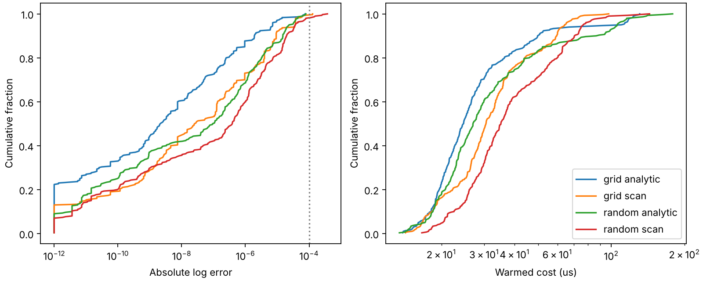

# Method 2b validation: degenerate-corner and clipping-cusp repair

M=40; grid spacing factor 1.3; residual sinh w<0.017; GH12 (GH32 in the corner), grid48/64/96/128, corrected sinh64, split GL32 per interval.
Cached brute-force references; absolute errors in ln L. Costs: median / mean / p99 us across per-point medians of three warmed compiled loops of 16 repetitions.

| Set | Rule | Max error | Fraction >1e-4 | Median / mean / p99 us |
|---|---|---:|---:|---:|
| regression | scan | 3.41661e-05 | 0.000% | 20.62 / 31.23 / 146.7 |
| regression | analytic before | 4.29791e-05 | 0.000% | 12.57 / 16.04 / 62.89 |
| regression | analytic after | 3.41661e-05 | 0.000% | 12.55 / 16.31 / 59.76 |
| stored_random | scan | 4.6903e-05 | 0.000% | 20.38 / 23.63 / 72.73 |
| stored_random | analytic before | 4.49523e-06 | 0.000% | 12.32 / 15.75 / 38.48 |
| stored_random | analytic after | 5.04145e-07 | 0.000% | 13.91 / 18.56 / 52.85 |
| fresh_random | scan | 9.3777e-05 | 0.000% | 20.87 / 27.13 / 161.7 |
| fresh_random | analytic before | 5.26649e-05 | 0.000% | 11.79 / 15.73 / 55.5 |
| fresh_random | analytic after | 9.3777e-05 | 0.000% | 12.97 / 18.71 / 78.76 |
| sampler_like | scan | 3.31976e-06 | 0.000% | 21.43 / 38.92 / 172.2 |
| sampler_like | analytic before | 1.59418e-05 | 0.000% | 4.852 / 14.8 / 68.99 |
| sampler_like | analytic after | 1.59418e-05 | 0.000% | 5.012 / 17.16 / 84.78 |
| repaired_cases | scan | 9.96658e-06 | 0.000% | 125.3 / 122.2 / 224 |
| repaired_cases | analytic before | 6.47566e-06 | 0.000% | 56.41 / 41.89 / 71.79 |
| repaired_cases | analytic after | 3.70451e-08 | 0.000% | 75.87 / 63.72 / 123 |

Before branches (GH / grid / sinh / split GL):

- regression: 55.000% / 40.000% / 5.000% / 0.000%
- stored_random: 50.667% / 47.000% / 1.667% / 0.667%
- fresh_random: 58.150% / 39.800% / 1.350% / 0.700%
- sampler_like: 74.700% / 25.000% / 0.200% / 0.100%
- repaired_cases: 28.571% / 42.857% / 28.571% / 0.000%

| Set | GH | Grid | Sinh | Split GL32 | Mean radial fallbacks: scan / old / no skip / skip | Nodes skipped | Max skip delta |
|---|---:|---:|---:|---:|---:|---:|---:|
| regression | 55.000% | 42.500% | 2.500% | 0.000% | 1.25 / 0.9 / 1.1 / 1.1 | 5.409% | 0 |
| stored_random | 51.000% | 47.333% | 1.667% | 0.000% | 0.65 / 0.4767 / 0.66 / 0.5767 | 5.023% | 3.55e-15 |
| fresh_random | 58.200% | 39.600% | 1.750% | 0.450% | 0.9865 / 0.773 / 0.9775 / 0.949 | 3.781% | 3.55e-15 |
| sampler_like | 74.900% | 24.900% | 0.200% | 0.000% | 3.18 / 3.3 / 4.322 / 4.275 | 3.287% | 0 |
| repaired_cases | 28.571% | 42.857% | 28.571% | 0.000% | 14.29 / 16.86 / 21.43 / 21.43 | 0.000% | 0 |

Overall analytic median / mean / p99: 6.667 / 18.04 / 83.88 us; max skip delta 3.55e-15; skipped 3.689% of nodes.
Proxy pruning first requires a weighted gap > M. A separate upper/lower integral bound certifies a summed relative loss <= exp(-25)=1.39e-11, regardless of proxy width-factor error. The maximum retained weighted node supplies the lower bound; every skipped node gets 1/N of the error budget. Both signs are included in the upper bound.
Widths for non-GH rules have a calibrated 0.8 safety factor (0.25 for q<0.01, eta<0.1); weak-axis resolution includes the prior RMS radius and distant-radius cores. Kinks use corrected sinh64 patches, with cuts weighted by the fourth root of widths when their ratio exceeds 10. Corner sinh scales are twice the conservative grid widths (three times for multiple patches). Smooth overlapping peaks outside the corner use GL32 intervals.
Kink width is min(one-sided curvature widths, sqrt(b)/abs(a_prime-b_prime*x0)). GH is forbidden for kinks. Candidate mass includes finite radial width; a=b=0 has pair mass 2*(xmin^-3-xmax^-3)/3 and supplies no singular endpoint candidate. Significant xmax shoulders are resolved even when they are not maxima.
For lambda2=eta=0, R^2<=lambda1, the exact null-axis maximum uses finite pair curvature (lambda1-R^2)*<r^2>_prior. Four additional independent reference regressions cover this sub-unit-SNR limit.
Outside the corner, r*sqrt(b)<6 invalidates the isolated radial-saddle width. For these formal proxy cusps, quadrature retains the broad prior/one-sided scale, forbids GH, and uses at least 64 grid nodes. This removes artificial narrow patches and resolves the audited prior-tail features.
Corner GH requires the peak to lie at least 20 widths from the weak axis. A full-Laplace refinement of the closed-form stationary seed retains radial-volume islands missing from the continuous proxy maxima. The default scan comparison retains its seeded scan search and shares fixed corner quadrature to avoid false nested convergence.
Real pedestal mass cannot be pruned. An optional precomputed composite GL12 rule in log radius accelerates unsafe-cell quadrature for the analytic rule on the validated priors; other domains retain the general direct kernel. Fallback counts still include these direct quadrature calls.
The no-skip comparison uses identical plans/nodes. Historical before costs are from the saved iteration-009 run, so scan/after on this run provide the direct cost comparison.

Grid error curves: all_grid

| N | Count | Max error | >1e-4 |
|---:|---:|---:|---:|
| 16 | 1452 | 2.26907 | 417 |
| 24 | 1452 | 1.79449 | 227 |
| 32 | 1452 | 0.487188 | 130 |
| 48 | 1452 | 0.0864632 | 56 |
| 64 | 1452 | 0.00943398 | 17 |
| 96 | 1452 | 5.67568e-05 | 0 |
| 128 | 1452 | 1.04453e-06 | 0 |

Grid error curves: former_fallback

| N | Count | Max error | >1e-4 |
|---:|---:|---:|---:|
| 16 | 40 | 50.2624 | 37 |
| 24 | 40 | 46.7 | 37 |
| 32 | 40 | 14.049 | 37 |
| 48 | 40 | 14.4545 | 37 |
| 64 | 40 | 14.7421 | 37 |
| 96 | 40 | 15.1476 | 36 |
| 128 | 40 | 15.4353 | 32 |

Grid error curves: former_fallback_width_ge_threshold

| N | Count | Max error | >1e-4 |
|---:|---:|---:|---:|
| 16 | 1 | 2.88726e-07 | 0 |
| 24 | 1 | 6.43197e-08 | 0 |
| 32 | 1 | 2.31601e-08 | 0 |
| 48 | 1 | 1.22338e-08 | 0 |
| 64 | 1 | 8.27379e-09 | 0 |
| 96 | 1 | 8.77166e-09 | 0 |
| 128 | 1 | 8.20616e-09 | 0 |

| Spacing / predicted w | Former-fallback (point,N) pairs | Max error | >1e-4 |
|---:|---:|---:|---:|
| 0.5 | 4 | 1.22338e-08 | 0 |
| 0.7 | 4 | 1.22338e-08 | 0 |
| 1.0 | 4 | 1.22338e-08 | 0 |
| 1.1 | 4 | 1.22338e-08 | 0 |
| 1.2 | 4 | 1.22338e-08 | 0 |
| 1.3 | 4 | 1.22338e-08 | 0 |
| 1.4 | 4 | 1.22338e-08 | 0 |

Maximum doubled-node difference: 9.37739e-05.

Geometry integral audit: 23469 points, max scan256 difference 4.23009e-05; 55 independent reference checks, max reference error 1.24104e-05, 0 failures above 1e-4.
Guard quadrature validation: {'10.0': {'probes': 16985, 'max_error': 1.6431300764452317e-14, 'above_1e8': 0, 'worst_ab': [18.67935156876167, 9.320033921747317]}, '100.0': {'probes': 40390, 'max_error': 8.895995051716454e-12, 'above_1e8': 0, 'worst_ab': [0.2944508851254676, 2.5622653524820953e-06]}, 'actual_nodes': {'probes': 223640, 'max_error': 1.9895196601282805e-12, 'above_1e8': 0}, 'elapsed_s': 3.3520741679999446}.
Mean and p99 below scan per set: {'regression': True, 'stored_random': True, 'fresh_random': True, 'sampler_like': True, 'repaired_cases': True}.

Points above 1e-4: none. Full point records: `data/method2b_check_full.json`.

## Degenerate corner (300 grid + 300 random points)

Random seed 90092; log10(lam1) uniform [3,7], rho=R/sqrt(lam1) log-uniform [1,300], independent 20% atoms at q=0 and eta=0. Prior (0.1,100); grid xi=0.3, random xi uniform [0,pi]. References: lnL_marg_ref, cached in ignored `data/degenerate_reference_full.json`.

| Set | Rule | Max error before / after | >1e-4 before / after | >1e-3 before / after |
|---|---|---:|---:|---:|
| grid | analytic | 0.63138 / 7.54376e-05 | 22 / 0 | 15 / 0 |
| grid | scan | 57.3999 / 0.000128787 | 12 / 2 | 6 / 0 |
| random | analytic | 0.522956 / 7.88898e-05 | 23 / 0 | 15 / 0 |
| random | scan | 37.4921 / 0.0003755 | 15 / 6 | 10 / 0 |

| Set | Rule | Median / mean / p99 us | Branch fractions |
|---|---|---:|---|
| grid | analytic | 24.68 / 32.15 / 123.4 | 3: 54.33%, 4: 14.33%, 5: 31.33% |
| grid | scan | 30.52 / 34.53 / 74.68 | 0: 0.33%, 1: 22.00%, 2: 0.67%, 3: 32.33%, 4: 19.33%, 5: 25.33% |
| random | analytic | 26.99 / 37.96 / 139.4 | 3: 33.00%, 4: 8.67%, 5: 58.33% |
| random | scan | 35.15 / 41.95 / 97.91 | 1: 8.67%, 3: 25.00%, 4: 11.00%, 5: 55.33% |

Branches 0/1/2: legacy uniform/sinh/split GL; 3/4/5/6: GH/grid/corrected sinh/split GL. The corner scan uses its seeded search with the same fixed quadrature; outside it the legacy rule is retained.

Analytic >1e-4: none.

| Remaining scan point | lam1 | q | eta | R/lam1 | Error |
|---|---:|---:|---:|---:|---:|
| grid_280 | 1e+07 | 0.01 | 0 | 0.05 | 0.000128787 |
| grid_284 | 1e+07 | 0.01 | 0.0001 | 0.05 | 0.000128405 |
| random_15 | 1.72457e+06 | 0.000111133 | 0.0285572 | 0.00103027 | 0.000260789 |
| random_56 | 105789 | 2.404e-09 | 0.000105499 | 0.0088663 | 0.000115031 |
| random_85 | 3.05219e+06 | 7.13052e-06 | 0.000387647 | 0.00276168 | 0.000154711 |
| random_145 | 1.23997e+06 | 5.61924e-05 | 0.00123582 | 0.00365066 | 0.000144602 |
| random_213 | 1.53089e+06 | 5.69683e-05 | 0.00214444 | 0.00364747 | 0.0003755 |
| random_241 | 143477 | 5.54122e-07 | 0.000201469 | 0.0166247 | 0.000249578 |

All remaining scan failures are near-degenerate weak-axis / clipped-prior regimes; none exceeds 1e-3.

