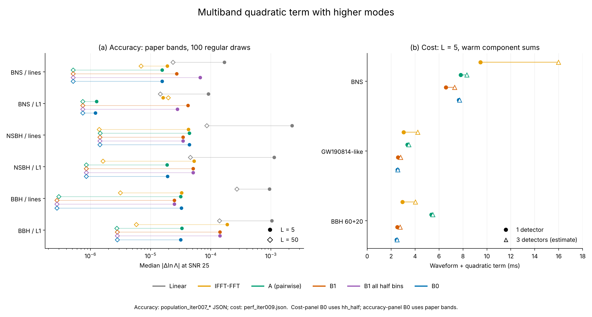
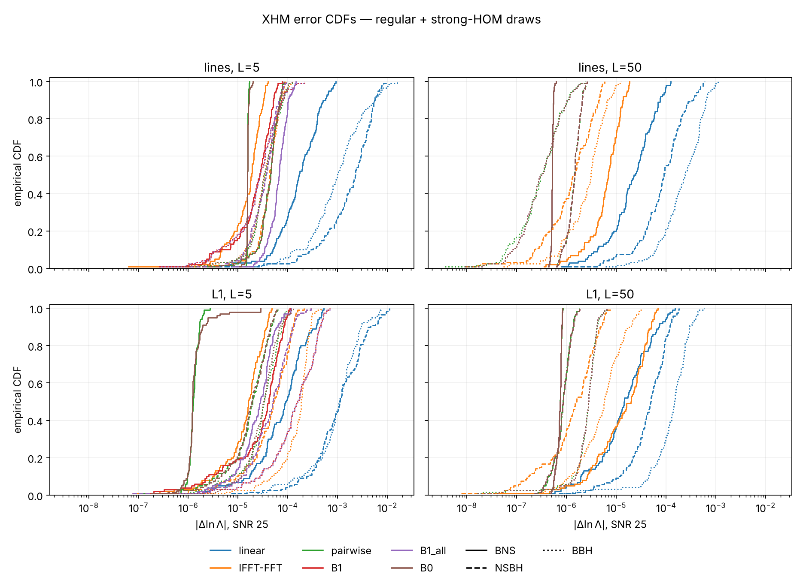
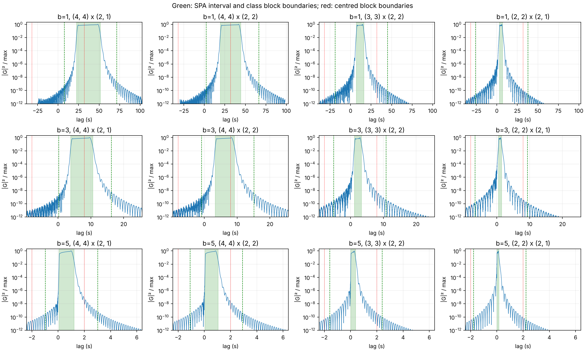
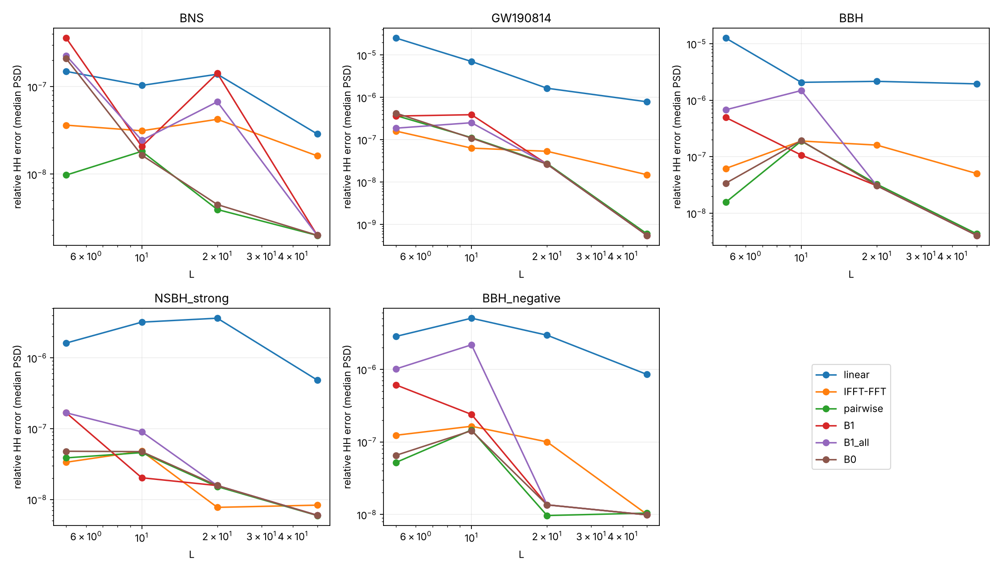

# Results: multiband quadratic terms with higher modes

## 1. Question and test design

Can the quadratic term in Morisaki (2021), PRD 104, 044062, Eq. (26), be
computed more cheaply than the paper's IFFT-FFT (Eqs. 31–46), retaining
higher-mode accuracy? Method A replaces transforms by mode-pair block
weights. B0 applies one centred weight vector to total power; B1 uses short
baseband transforms when B0's lag support does not fit. The derivation,
conventions and API are in [METHOD_NOTE.md](METHOD_NOTE.md).

The practical recommendation is **B0 with the optional `hh_half` band
rule** when only total strain is available. A is useful for extrinsic
matrix reuse and common-time independence when modes are available. B1
is the fallback for fixed band edges, with accuracy checked at the chosen
L. None is an unconditional replacement under all original ratio criteria.

All references are brute-force Eq. (4) on the positive fine-frequency
sequence, excluding DC/Nyquist. The reported likelihood diagnostic holds
`(d,h)` fixed: `|Delta ln Lambda| = rho^2 epsilon/2`, where
`epsilon=|HH_approx/HH_exact-1|`. At SNR 25 the multiplier is 312.5;
SNR 50/100 multiply likelihood errors by 4/16. This is not a full
likelihood or posterior test. The baseline is the optimised real-FFT
implementation, numerically equivalent to the literal paper algorithm.

| Fixed XHM system | Masses (solar masses), aligned spins | T; band durations (s) | Frequency range (Hz) | Band Mc_ref; block Mc range | K_MB, L=5 |
|---|---|---|---|---|---:|
| BNS | 1.4+1.4; 0,0 | 256; 256,128,64,32,16,8,4 | 20–2048 | 1.15; [1.15,1.25] | 20167 |
| GW190814-like | 23+2.6; .1,0 | 16; 16,8,4 | 20–1024 | 6.4; [6,7] | 4865 |
| BBH | 60+20; .3,-.2 | 16; 16,8,4 | 20–1024 | 25; [25,35] | 4408 |

Sources: [data/xhm_accuracy_iter005.md](data/xhm_accuracy_iter005.md),
[data/pairwise_tuning_iter006.md](data/pairwise_tuning_iter006.md),
[data/prior_slack_iter008.md](data/prior_slack_iter008.md), and parameter
definitions in [mbquad/testcases.py](mbquad/testcases.py). All use
`dt=1/4096 s`, so the BNS reference is the full `N=2^20` problem, already
run in iterations 005–009. Fixed accuracy varies inclination over
`{0.3,1.0,1.4}`; timing uses nominal parameters. The nominal GW190814-like
chirp mass is below the historical Eq. (51) reference 6.4, although inside
the block corners. This is a band-prior exception, not an in-prior accuracy
proof. The fixed `q=.1` variants keep m1 unchanged and fall below both
nominal design ranges.

The population study uses 100 regular draws per class, plus 20 separate
strong-HOM draws for each NSBH/BBH class (seed 20261017). Priors are mass
boxes, conditioned on `Mc>=Mc_ref`, ordered masses, and BBH `q>=.1`:

| Population | Component masses (solar masses) | Spin prior | Mc_ref / block corners | K_MB, L=5 / 50 |
|---|---|---|---|---:|
| BNS | [1.2,2] each | each [-.05,.05] | 1 / [1,1.8] | 21653 / 30422 |
| NSBH | [15,35] x [1.5,4] | chi1 [-.5,.5], chi2=0 | 4 / [4,9] | 5128 / 6490 |
| BBH | [30,80] x [10,40] | each [-.8,.8] | 12 / [12,50] | 4610 / 5549 |

Sources: [data/prior_slack_iter008.md](data/prior_slack_iter008.md),
[data/population_iter007.md](data/population_iter007.md) and corresponding
JSON `setup` fields. Inclinations are isotropic; phase, response orientation
and `t_c in [T-2.12,T-1.9]` vary. Strong draws additionally require
`q<=.15`, `1.3<iota<1.8`, and `Mc<=Mc_max`. One regular NSBH draw exceeds
the upper corner 9; it remains flagged in primary statistics, with a
separate inside-corners sensitivity table.

PSDs are analytic aLIGO plus narrow lines, and measured L1 Welch data at
1/16-Hz resolution, log-log interpolated. The fixed cases use Gaussian
TOY_LINES; populations use the recorded common Lorentzian list, including
lines in every BNS band and near internal edges. Interpolation does not
recover unresolved measured features. All five XHM mode contributions,
including corrected OneMode high-frequency tails, are retained.

## 2. Accuracy: fixed cases and populations

Fixed-case summaries below are median / worst **relative HH error**, L=5.
The GW190814-like and BBH rows include the out-of-design `q=.1` variants;
they are reproduced without filtering.

| System | Linear | IFFT-FFT | A | B0 | B1 |
|---|---|---|---|---|---|
| BNS | 1.268e-7 / 2.526e-7 | 3.489e-8 / 4.906e-8 | 1.035e-8 / 1.159e-8 | 1.251e-7 / 4.365e-7 | 3.556e-7 / 5.241e-7 |
| GW190814-like | 1.288e-5 / 1.140e-4 | 1.642e-7 / 3.346e-7 | 3.553e-7 / 4.281e-7 | 3.346e-7 / 1.776e-6 | 2.825e-7 / 5.199e-7 |
| BBH | 1.393e-5 / 1.255e-4 | 1.051e-7 / 5.424e-6 | 2.031e-8 / 2.702e-5 | 3.771e-8 / 6.230e-5 | 6.012e-7 / 2.693e-5 |

The same entries in median / worst `|Delta ln Lambda|`, SNR 25:

| System | Linear | IFFT-FFT | A | B0 | B1 |
|---|---|---|---|---|---|
| BNS | 3.964e-5 / 7.894e-5 | 1.090e-5 / 1.533e-5 | 3.233e-6 / 3.622e-6 | 3.910e-5 / 1.364e-4 | 1.111e-4 / 1.638e-4 |
| GW190814-like | 4.024e-3 / 3.562e-2 | 5.130e-5 / 1.045e-4 | 1.110e-4 / 1.338e-4 | 1.046e-4 / 5.550e-4 | 8.827e-5 / 1.625e-4 |
| BBH | 4.354e-3 / 3.922e-2 | 3.285e-5 / 1.695e-3 | 6.346e-6 / 8.443e-3 | 1.178e-5 / 1.947e-2 | 1.879e-4 / 8.415e-3 |

Source for both tables: [data/xhm_accuracy_iter005.md](data/xhm_accuracy_iter005.md).
The large BBH worst cases cannot be used as in-prior failures or discarded
without disclosure. A later six-case nominal GW190814-like study (no
`q=.1` variants) gives A `3.626e-7` median versus IFFT-FFT `1.539e-7`:
changing off-diagonal margins does not remove the class-zero diagonal
period-T_b folding floor ([data/pairwise_tuning_iter006.md](data/pairwise_tuning_iter006.md)).

The population headline tables below use **regular draws only**. Cells
are median / p99 `|Delta ln Lambda|` at SNR 25; parentheses give the ratios
of these statistics to IFFT-FFT, not medians of pointwise ratios.

Paper bands, L=5. Source: [data/population_iter007.md](data/population_iter007.md), `regular` rows.

| Population / PSD | IFFT-FFT | A (ratios) | B1 (ratios) | B0 |
|---|---|---|---|---|
| BNS / lines | 1.889e-05 / 3.872e-05 | 1.552e-05 / 1.673e-05 (0.822 / 0.432) | 2.723e-05 / 6.295e-05 (1.442 / 1.626) | 1.552e-05 / 1.945e-05 |
| BNS / L1 | 1.604e-05 / 4.611e-05 | 1.263e-06 / 2.064e-06 (0.079 / 0.045) | 4.179e-05 / 1.041e-04 (2.605 / 2.257) | 1.212e-06 / 2.848e-05 |
| NSBH / lines | 4.259e-05 / 8.754e-05 | 4.420e-05 / 8.005e-05 (1.038 / 0.914) | 3.468e-05 / 8.661e-05 (0.814 / 0.989) | 4.422e-05 / 7.975e-05 |
| NSBH / L1 | 5.253e-05 / 1.561e-04 | 1.878e-05 / 6.121e-05 (0.357 / 0.392) | 5.106e-05 / 2.333e-04 (0.972 / 1.494) | 1.904e-05 / 5.942e-05 |
| BBH / lines | 3.288e-05 / 1.147e-04 | 3.163e-05 / 1.035e-04 (0.962 / 0.902) | 2.490e-05 / 1.335e-04 (0.757 / 1.164) | 3.234e-05 / 1.063e-04 |
| BBH / L1 | 1.873e-04 / 3.123e-04 | 3.292e-05 / 9.216e-05 (0.176 / 0.295) | 1.419e-04 / 5.320e-04 (0.758 / 1.704) | 3.164e-05 / 1.107e-04 |

Paper bands, L=50. Source: [data/population_iter007.md](data/population_iter007.md), `regular` rows.

| Population / PSD | IFFT-FFT | A (ratios) | B1 (ratios) | B0 |
|---|---|---|---|---|
| BNS / lines | 6.915e-06 / 1.812e-05 | 5.130e-07 / 5.843e-07 (0.074 / 0.032) | 5.131e-07 / 5.844e-07 (0.074 / 0.032) | 5.131e-07 / 5.844e-07 |
| BNS / L1 | 1.968e-05 / 6.372e-05 | 7.430e-07 / 8.284e-07 (0.038 / 0.013) | 7.443e-07 / 8.236e-07 (0.038 / 0.013) | 7.443e-07 / 8.236e-07 |
| NSBH / lines | 1.393e-06 / 5.100e-06 | 1.445e-06 / 2.422e-06 (1.038 / 0.475) | 1.440e-06 / 2.406e-06 (1.034 / 0.472) | 1.440e-06 / 2.406e-06 |
| NSBH / L1 | 1.605e-06 / 5.996e-06 | 8.509e-07 / 1.787e-06 (0.530 / 0.298) | 8.475e-07 / 1.800e-06 (0.528 / 0.300) | 8.475e-07 / 1.800e-06 |
| BBH / lines | 3.127e-06 / 9.773e-06 | 2.965e-07 / 1.914e-06 (0.095 / 0.196) | 2.768e-07 / 1.967e-06 (0.089 / 0.201) | 2.768e-07 / 1.967e-06 |
| BBH / L1 | 5.771e-06 / 2.773e-05 | 2.750e-06 / 5.543e-06 (0.476 / 0.200) | 2.785e-06 / 5.493e-06 (0.483 / 0.198) | 2.785e-06 / 5.493e-06 |

Divide these numbers by 312.5 for relative HH errors. Regular L=5 maxima
are A `1.246e-4`, B0 `1.214e-4`, B1 `6.117e-4` in likelihood units
(relative `3.988e-7`, `3.886e-7`, `1.957e-6`); the source provides medians
and maxima in both units for every method. At L=50 B1 executes B0 in all
truncated bands; A is close, but not identical.

Separate strong-HOM A median ratios at L=5 range `0.279–0.989`, with all
p99 ratios below one. B1 BBH stress p99 ratios are `2.055` (lines) and
`1.835` (L1), failing C1'. Pooling regular and stress draws changes the
quantiles: BBH/lines A L=5 median ratio becomes `1.042`, although both
separate subsets pass. Removing the above-corner NSBH draw gives A/lines
median ratios `1.028` at L=5 and `0.967` at L=50. These are additional
qualifications, not retuned priors
([data/population_iter007.md](data/population_iter007.md)).

Synthetic controls remain important: the four SPA cases give A median /
worst relative errors `2.873e-7 / 3.536e-7` (likelihood
`8.977e-5 / 1.105e-4`), versus IFFT-FFT `2.234e-7 / 2.938e-7`.
The exaggerated strong-HOM line toy gives B0 `8.938e-6` relative /
`2.793e-3` likelihood, compared with B1 `2.732e-7` / `8.537e-5`.
XHM population success alone is insufficient to make B0 on paper L=5
bands universal ([data/accuracy_iter003.md](data/accuracy_iter003.md),
[data/accuracy_iter004.md](data/accuracy_iter004.md)).

## 3. Band design and the hh_half option

`hh_half` raises Eq. (51) edges until the predicted total-power lag extent
plus margin fits in a centred half-period:
`2[Lambda_max(f_lo)+L_hh sigma_mmax(f_lo)] <= T_b`.
For `L=L_hh=5` adaptive B1 selects B0 in every truncated band.

| Fixed system | K_MB paper -> hh_half (increase) | B0 hh_half epsilon, median / worst | B0 likelihood, median / worst | IFFT-FFT on paper bands epsilon, median / worst |
|---|---|---|---|---|
| BNS | 20167 -> 24770 (22.82%) | 4.39e-10 / 8.09e-10 | 1.37e-7 / 2.53e-7 | 3.63e-8 / 4.80e-8 |
| GW190814-like | 4865 -> 4994 (2.65%) | 1.64e-7 / 1.84e-7 | 5.12e-5 / 5.74e-5 | 1.60e-7 / 1.75e-7 |
| BBH | 4408 -> 4497 (2.02%) | 1.97e-8 / 3.57e-8 | 6.16e-6 / 1.12e-5 | 6.17e-8 / 1.16e-7 |
| Strong NSBH | 5128 -> 5280 (2.96%) | 4.78e-9 / 6.07e-9 | 1.49e-6 / 1.90e-6 | 3.35e-8 / 4.33e-8 |
| Negative-spin BBH | 4408 -> 4497 (2.02%) | 3.39e-8 / 6.38e-8 | 1.06e-5 / 1.99e-5 | 1.24e-7 / 2.05e-7 |

Source: [data/bandrule_iter008.md](data/bandrule_iter008.md), `hh_half`
rows and the **paper-rule L scan** for the last column. Its hh_half table's
own IFFT-FFT column is on hh_half bands and is a different comparator.
The GW190814-like hh_half B0 median is slightly above the paper-band
IFFT-FFT median; “at or below everywhere” is too strong. L_hh=3 or 8 is
not consistently better. These are fixed-system, two-PSD results, not
population certification of hh_half.

The prior phase audit finds no negative truncated-band measured clearance:
minimum `1.008510 / 0.956317 / 0.871841 s` across `42 / 45 / 54` mass/spin
points for BNS/NSBH/BBH. It measures stationary tracks, not tails. Equal-spin
slices do not establish arbitrary differential-spin coverage. The m=5
probe was unavailable; those classes use labelled Newtonian fallbacks.
Skipped band durations remain power-of-two subdivisions
([data/prior_slack_iter008.md](data/prior_slack_iter008.md)).

At fixed block length, small centre displacements leave the diagonal-fold
floor; forcing the bulk outside gives relative error `8.35e-4`, likelihood
`0.261`, at clearance `-5.889 s`. Increasing band L suppresses errors with
nonmonotone cancellations: fitted A/IFFT-FFT slopes are `-0.84/-0.30`
(BNS), `-2.77/-0.97` (GW190814-like), `-0.81/-0.15` (BBH). These are not
the Appendix A16/A20 envelope powers `-3/-2`
([data/bandrule_iter008.md](data/bandrule_iter008.md)).

## 4. Cost, routes and precomputation

Warm median wall times on this machine; waveform evaluation is separate
from the quadratic step. Seven interleaved batches, one OpenMP/BLAS thread,
SciPy FFT workers=1; JIT/import/setup excluded. L=5 unless stated.

| Component (ms) | BNS | GW190814-like | BBH | BNS L=50 |
|---|---:|---:|---:|---:|
| Raw polarizations | 6.0436 | 2.2299 | 2.1061 | 8.2769 |
| Raw five OneMode | 6.3131 | 2.9548 | 2.0034 | 8.9248 |
| LAL tail recovery | .0003 | .0003 | 2.6015 | .0003 |
| Prepared total | 6.2072 | 2.4600 | 2.4018 | 9.0028 |
| Prepared modes | 7.5670 | 3.2867 | 5.2932 | 10.4915 |
| IFFT-FFT fast step | 3.2570 | .5880 | .5392 | 4.4908 |
| A NumPy / numba step | .5576 / .2522 | .1572 / .0610 | .1676 / .0577 | .6771 / .3394 |
| B1 numba step | .3638 | .1065 | .1127 | .0270 |
| B0 hh_half numba step | .0308 | .0109 | .0109 | .0315 |
| Mode matrix numba | .6193 | .1467 | .1296 | .8210 |

Source: [data/perf_iter009.md](data/perf_iter009.md). The full-scale BNS
uses K_MB `20167 / 28543` at L=5/50. Fast quadratic steps save substantial
transform time, but per-mode generation and BBH tail recovery can dominate.
Instrumented GW190814-like routes leave `.1884–.3388 ms` bookkeeping,
versus `.0071–.1316 ms` kernels
([data/profile_overhead_iter009.md](data/profile_overhead_iter009.md)).

Route costs below are **component sums**, waveform once plus D quadratic
steps; cells are ms (ratio to fast IFFT-FFT on paper bands). Identical
PSD/kernel costs and negligible additional detector projection are assumed.
B0 hh_half waveform time is scaled by its K_MB ratio. No `(d,h)`, prior or
sampler work is included; three-detector numbers are estimates.

| D | Route | BNS | GW190814-like | BBH |
|---:|---|---:|---:|---:|
| 1 | IFFT-FFT | 9.4642 (1) | 3.0480 (1) | 2.9409 (1) |
| 1 | A | 7.8192 (.826) | 3.3477 (1.098) | 5.3509 (1.819) |
| 1 | B1 | 6.5710 (.694) | 2.5665 (.842) | 2.5145 (.855) |
| 1 | B0 hh_half | 7.6547 (.809) | 2.5361 (.832) | 2.4611 (.837) |
| 3 | IFFT-FFT | 15.9782 (1) | 4.2241 (1) | 4.0193 (1) |
| 3 | A | 8.3236 (.521) | 3.4697 (.821) | 5.4663 (1.360) |
| 3 | B1 | 7.2987 (.457) | 2.7794 (.658) | 2.7400 (.682) |
| 3 | B0 hh_half | 7.7163 (.483) | 2.5580 (.606) | 2.4829 (.618) |

Source: [data/perf_iter009.md](data/perf_iter009.md). Measured complete
one-detector B0 hh_half routes are `7.7506 / 2.4733 / 2.2910 ms`; measured
IFFT-FFT routes `9.5072 / 3.1524 / 2.9580 ms`. They need not equal sums
of separately measured medians. Iteration-008 extrapolations used older
NumPy component timings and are not the final cost table. BNS L=50 final
component sums are IFFT-FFT `13.4936 / 22.4751 ms` and B0 hh_half
`9.0342 / 9.0972 ms` for one/three detectors (same source).

BNS fresh-constructor precomputation (seconds and decimal MB):

| L | Evaluator | seconds | BlockWeights MB | retained arrays MB | traced peak MB |
|---:|---|---:|---:|---:|---:|
| 5 | IFFT-FFT fast | .1001 | 0 | 4.389 | 88.703 |
| 5 | A numba | .1514 | 50.528 | 64.726 | 87.561 |
| 5 | B1 numba | .1163 | 41.878 | 43.545 | 87.560 |
| 5 | B0 hh_half numba | .1098 | 39.518 | 40.509 | 87.560 |
| 50 | A numba | .2271 | 58.851 | 78.946 | 91.755 |
| 50 | B0 hh_half numba | .1186 | 43.909 | 45.051 | 91.754 |

Source: [data/perf_iter009.md](data/perf_iter009.md). Constructor medians
exclude caller-owned bands/PSD and first JIT dispatch; traced peak is a
separate allocation measurement, not total process RSS. The table's
largest peak across evaluators is 92.674 MB, below 200 MB; all constructors
are below 60 s. Weights are per fixed detector PSD and setup/prior, reused
across intrinsic evaluations; matrices can additionally be reused over
extrinsics. No waveform values are cached between timed evaluations.

## 5. Figures and interpretation

**Summary figure.** Left: all six recorded methods, regular-population
medians by PSD, L=5/50; B0 uses paper bands. Right: final L=5 route
component sums for one/three detectors; B0 uses hh_half. Sources are the
iteration-007 population JSON summaries and `data/perf_iter009.json`.
Reproduce with `python scripts/make_report_figure.py`; no waveforms run.

**CDFs.** The existing Fig. 4-style diagnostic combines regular and
strong-HOM draws; this differs from the regular-only headline tables.
Method A and B0 cluster well below linear interpolation, with the B1 L=5
qualifications visible in the tails. Source: [data/population_iter007.md](data/population_iter007.md).

[BNS scatter](figures/iter007_errors_bns.png),
[NSBH scatter](figures/iter007_errors_nsbh.png), and
[BBH scatter](figures/iter007_errors_bbh.png) show every draw; stress points
are appended at the right. They retain rare failures hidden by medians
and demonstrate that L=50 errors need not match the paper baseline point
by point. Source: the same population tables and per-point JSON.

**Lag audit.** SPA toy inverse-transform power is concentrated at positive
lags for the slower mode first. Class blocks encompass the predicted
interval; zero-centred blocks cut the bulk of extreme pairs in lower
bands. This is a support diagnosis, not a PSD-weighted error bound.
Source: [data/margin_study_iter003.md](data/margin_study_iter003.md).

**L scan.** Medians over two PSDs at fixed inclination show moving-edge
cancellations and adaptive B0 transitions; universal asymptotic slopes
cannot be inferred from these points. Source:
[data/bandrule_iter008.md](data/bandrule_iter008.md).
Additional [slack](figures/iter008_slack.png) and
[time-scan](figures/iter007_tc_scan.png) figures document deliberate loss
of coverage and cancellation of common phase. A varies by at most
`3.937923e-16` relative over the time scan; linear and B0 are invariant
too. Complex-interpolating IFFT-FFT/B1 can vary with time
([data/tc_scan_iter007.md](data/tc_scan_iter007.md)).

## 6. Verdicts against TASK.md

The original thresholds remain the basis of these verdicts. An absolute
SNR-25 level is useful context, not an approved replacement criterion.

- **C1 — qualified; not fully met.** A regular NSBH/lines median ratio is
  1.038 at both L=5 and 50 (p99 .914/.475); removing the upper-corner draw
  leaves 1.028 at L=5, .967 at L=50. Other regular and separate stress
  populations pass. Combined BBH/lines at L=5 adds a 1.042 median ratio
  failure. Fixed GW190814-like medians are 3.553e-7 versus 1.642e-7
  (with the historical band-reference exception); SPA four-case medians
  are 2.873e-7 versus 2.234e-7. Thus the literal all-cases median threshold
  is not achieved, even where absolute errors are small.
- **C1' — B1 fails at L=5; passes the recorded populations at L=50.**
  BNS/lines ratios are 1.442/1.626 and BNS/L1 2.605/2.257; BBH/L1 regular
  p99 is 1.704, strong BBH p99 2.055/1.835 (lines/L1), above 1.5.
  Fixed BNS B1 median 3.556e-7 versus 3.489e-8 also fails equivalence.
  B0 hh_half fixed-case worst is 1.84e-7 relative / 5.74e-5 likelihood;
  it has no corresponding hh_half population certification.
- **C2 — met with opt-in numba; NumPy-only A target has an exception.**
  A/fast step ratios .0774/.1037/.1070 and A/raw-five-mode ratios
  .0399/.0206/.0288 pass; B1/fast .1117/.1810/.2091 pass (BNS/GW190814/BBH).
  NumPy A on GW190814 is .1572/.5880 = .2673, above .2; BNS passes at
  .5576/3.2570 = .1712. BNS setup peaks <=92.674 MB and constructor
  times <=.2271 s meet 200 MB / 60 s. These are step/setup criteria,
  not evidence of a universal end-to-end gain for A.
- **C3 — supported within the audited scope.** Prior-grid minimum measured
  clearances 1.008510/.956317/.871841 s are positive; displacement to
  -5.889 s gives 8.35e-4 relative error. hh_half adds 22.82%/2.65%/2.02%
  coarse points for the nominal systems and enables B0 throughout.
  Window tails, differential spins, unavailable 55 and precession remain
  outside a general coverage guarantee; measured L slopes are not -3/-2.
- **C4 — met for this delivery.** METHOD_NOTE.md, REPORT.md, README.md,
  the JSON-driven summary figure script and existing diagnostic figures
  are present; `python -m pytest tests -q` passes all 170 tests. Tests
  include full-block and conjugacy identities, the correctly symmetrised
  Eq. (45) relation, regression accuracy and numba agreement. B1 is not
  asserted identical to the paper's finite interpolant.
- **C5 — factorisation verified, strict phase independence qualified.**
  `C^dagger M C` reproduces direct A to 5.77316e-15 relative (with API
  4/T restored). Other extrinsics leave raw matrices identical; varying
  phi_ref changes the max-scaled matrix by 6.54606e-13 because LAL mixed
  32 retains a 1.33194e-5 phase residual. Common-time invariance holds to
  roundoff; the strict all-extrinsics requirement is not established.

Sources for verdicts: [accuracy_iter003.md](data/accuracy_iter003.md),
[xhm_accuracy_iter005.md](data/xhm_accuracy_iter005.md),
[population_iter007.md](data/population_iter007.md),
[bandrule_iter008.md](data/bandrule_iter008.md),
[prior_slack_iter008.md](data/prior_slack_iter008.md),
[perf_iter009.md](data/perf_iter009.md). C4 is verified in this delivery.

## 7. Recommendations and record reconciliation

For bilby's `MBGravitationalWaveTransient`, first port B0 weight
precomputation and the optional hh_half band rule. Keep Eq. (24)'s linear
term on the resulting grids, preserving windows, overlaps and frequency
normalisation. Validate the whole likelihood against its fine-grid route,
including actual detector PSDs, priors and marginalisations. Keep baseline
IFFT-FFT available. Where edges cannot change, port B1's baseband and
half-shift route with adaptive B0, expose L and validate its finite-tail
accuracy rather than promising exact interpolant equality.

When arbitrary-frequency raw modes are available, port A's class weights,
prior-corner placement, slack checks and matrix API. This is especially
useful when time/extrinsic reuse matters. Preserve LAL signed-mode
projection and high-frequency recovery; factor out only extrinsics the
waveform API actually separates. Use opt-in fused kernels and prepared
frequency maps. PSD updates require new weights. No production default
was changed here.

The following discrepancies/qualifications were found while reconciling
the record; the underlying tables have not been edited:

- Population CDFs use combined draws, while the common C1 summary refers
  to regular and stress subsets separately. The combined BBH/lines
  median failure (1.042) must also be disclosed. L=50 BBH/L1 A ratio is
  .476, so the shorthand “BNS/BBH .04–.10” does not cover both PSDs.
- “All new-method medians <=1.4e-4” is a rounded regular-population
  statement, not a stress bound: strong BBH/L1 B1 is 2.138e-4 (combined
  1.573e-4). Regular BBH/L1 B1 is 1.419e-4. See population tables.
- The hh_half table's IFFT-FFT numbers are on hh_half bands. Using them
  as paper-band baselines gives incorrect comparisons. Its B0
  GW190814-like median 1.64e-7 is slightly above the paper-band 1.60e-7.
- Iteration-005 eight-case summaries, iteration-006 six-case tuning,
  iteration-008 two-PSD scans at inclination 1, and iteration-009 nominal
  timing-case accuracy cover different points. Their medians are not
  interchangeable; fixed and population reference masses also differ.
  The historical [band_tables.md](data/band_tables.md) retains an 8-s BBH
  geometry, while final fixed XHM studies use 16 s.
- The nominal GW190814-like point is below the Eq. (51) reference mass;
  low-Mc q=.1 variants are outside the design prior. Earlier “in-prior”
  shorthand needs this exception. The population NSBH mass box extends
  above its upper block corner; primary tables retain the flagged draw.
- Earlier B1 exactness and weight-normalisation expectations were
  corrected in accuracy_iter004; equality only follows for the correct
  symmetrised full-spectrum identity. Padding/endpoint fixes are not a
  demonstrated universal cure (b1_variants_iter006).
- Negative unwrapped band-zero slack is harmless on the full circular
  grid. Constructor clipping is a warning, not automatic rejection of a
  bad truncated setup. “Non-dyadic” audits mean skipped dyadic levels;
  m=5 fallback classes are not measured XHM 55 evidence.
- Route estimates, measured complete calls, instrumented overhead and
  older thread-contaminated iteration-005 timings are different
  measurements. Use iteration-009 component sums for the headline route
  comparison and its measured table for one-detector cross-checks.
